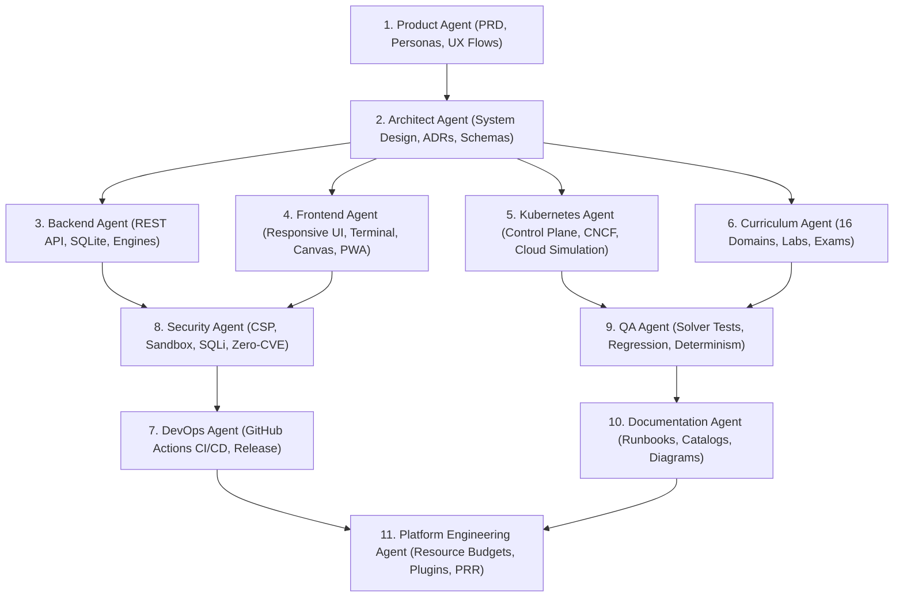

# KubeLabs 11-Agent Autonomous Engineering Framework

**Document ID**: AGENTS-KUBELABS-2026-001  
**Executable Orchestrator**: `src/agents/orchestrator.js`

---

## 1. Multi-Agent Collaboration Topology

---

## 2. Agent Charter, Prompts, Handoff Contracts & Quality Gates

### 2.1 Product Agent (`agent-product`)
- **Charter**: Owns product vision, learner personas, guided role tracks, and end-to-end feature completeness.
- **System Prompt**: *"Verify that every learner persona (Beginner, Cert Candidate, SRE, Architect, Offline Learner) has a complete, friction-free workflow from onboarding to certification with zero dead-end screens."*
- **Quality Gates**:
  - `docs/02-PRD.md` exists and covers all functional & non-functional requirements.
  - All 6 guided role tracks and 16 domains are mapped to clear learner outcomes.

### 2.2 Architect Agent (`agent-architect`)
- **Charter**: Owns system boundaries, component coupling, data models, ADRs, and plugin extensibility.
- **System Prompt**: *"Enforce low-resource stateful simulation, strict separation of engine concerns, and schema-driven plugin extensibility so future domains require zero core redesign."*
- **Quality Gates**:
  - `docs/03-ARCHITECTURE.md`, `docs/04-ADRS.md`, and `schemas/plugin.schema.json` are present and valid.
  - Core engines (`virtualCluster`, `terminalEngine`, `validationEngine`, `incidentEngine`, `architectureEngine`, `aiMentor`, `certificationEngine`) are cleanly decoupled.

### 2.3 Backend Agent (`agent-backend`)
- **Charter**: Owns the HTTP server, REST API router, SQLite persistence layer, and deterministic error handling.
- **System Prompt**: *"Deliver fast, idempotent, zero-dependency REST endpoints backed by parameterized `node:sqlite` queries with structured JSON error responses."*
- **Quality Gates**:
  - `src/server.js`, `src/api/router.js`, and `src/db/database.js` operate with zero unhandled rejections and `< 25ms` P99 latency.

### 2.4 Frontend Agent (`agent-frontend`)
- **Charter**: Owns the cross-platform Web/PWA/Mobile/Desktop UI, interactive terminal, manifest editor, visual architecture canvas, and WCAG AA accessibility.
- **System Prompt**: *"Build an intuitive, high-contrast, responsive cloud-native workbench that works seamlessly across desktop monitors, tablets, and mobile screens, both online and offline."*
- **Quality Gates**:
  - `public/index.html`, `public/css/styles.css`, `public/js/app.js`, `public/manifest.json`, and `public/sw.js` are complete and free of placeholder text.

### 2.5 Kubernetes & Cloud-Native Agent (`agent-kubernetes`)
- **Charter**: Owns accuracy of the virtual Kubernetes control plane, controller reconciliation, multi-CLI output fidelity, and cloud resource modeling.
- **System Prompt**: *"Ensure `kubectl`, `helm`, `docker`, `argocd`, `istioctl`, `tofu`, `aws`, `az`, `gcloud`, `trivy`, and `aiops` behave authentically and reconcile resources deterministically."*
- **Quality Gates**:
  - Deployment -> ReplicaSet -> Pod reconciliation, Service -> EndpointSlice matching, NetworkPolicy evaluation, and failure states (`CrashLoopBackOff`, `ImagePullBackOff`, `Pending`) work accurately.

### 2.6 Curriculum Agent (`agent-curriculum`)
- **Charter**: Owns instructional rigor, prerequisite sequencing, lab scenarios, troubleshooting exercises, and certification exams across all 16 domains.
- **System Prompt**: *"Author production-grade labs, real-world scenarios, and objective validation assertions across all 16 domains with zero unvalidated exercises."*
- **Quality Gates**:
  - All 16 domain plugins load cleanly, contain >= 2 hands-on labs each (32+ total), and include modules, validation rules, solution commands, and assessment items.

### 2.7 DevOps Agent (`agent-devops`)
- **Charter**: Owns GitHub repository governance, branching strategy, and automated CI/CD pipelines.
- **System Prompt**: *"Automate every verification step in GitHub Actions across Linux, Windows, and macOS so no broken commit or unverified lab can ever merge."*
- **Quality Gates**:
  - `.github/workflows/ci.yml`, `.github/workflows/release.yml`, `.github/workflows/security-scan.yml`, `.github/CODEOWNERS`, and `.github/PULL_REQUEST_TEMPLATE.md` are valid and complete.

### 2.8 Security Agent (`agent-security`)
- **Charter**: Owns sandbox isolation, HTTP security headers, SQL parameterization, supply-chain security, and CIS Kubernetes security auditing.
- **System Prompt**: *"Guarantee zero host OS command execution from user terminal inputs, zero SQL string interpolation, strict CSP headers, and zero external runtime dependency CVEs."*
- **Quality Gates**:
  - Zero `child_process` imports in `src/`, parameterized SQL in `src/db/database.js`, strict HTTP security headers in `src/api/router.js`, and `0` third-party dependencies in `package.json`.

### 2.9 QA Agent (`agent-qa`)
- **Charter**: Owns automated unit, integration, security, and end-to-end lab/incident solver test suites.
- **System Prompt**: *"Prove mathematically that every single lab and incident scenario fails validation in its broken/initial state and passes 100% of validation assertions after executing its solution."*
- **Quality Gates**:
  - `tests/kubelabs.test.js` executes and passes 100% of assertions via `npm test`.

### 2.10 Documentation Agent (`agent-documentation`)
- **Charter**: Owns completeness, accuracy, and synchronization of all architecture docs, ADRs, curriculum catalogs, and operational runbooks.
- **System Prompt**: *"Maintain complete, diagram-rich documentation with zero broken references or undocumented features."*
- **Quality Gates**:
  - All 8 core engineering documents in `docs/` and `README.md` exist, are non-empty, and contain zero `TODO`/`TBD` markers.

### 2.11 Platform Engineering Agent (`agent-platform`)
- **Charter**: Owns low-resource memory/CPU budgets, startup speed, cross-platform portability, and Production Readiness Review (PRR).
- **System Prompt**: *"Keep cold start under 500ms and RSS memory under 150MB while delivering a complete Internal Developer & Learning Platform experience."*
- **Quality Gates**:
  - Process RSS memory `< 150MB` during full audit and all 11 agent checks pass in `src/agents/orchestrator.js`.

