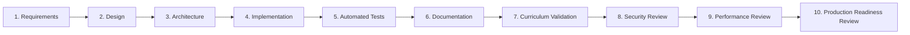

# Global Engineering Contract (GEC-v1.0)

**Platform**: KubeLabs — Standalone Cross-Platform Cloud-Native & Kubernetes Learn-by-Doing Platform  
**Status**: Active & Enforced  
**Version**: 1.0.0  
**Owners**: Principal Architect, Product Lead, Curriculum Lead, Security Lead, QA Lead, TPM

---

## 1. Mission & Engineering Philosophy

KubeLabs exists to democratize hands-on mastery of Kubernetes, CNCF, Linux, Networking, GitOps, DevSecOps, Observability, SRE, Platform Engineering, Multi-Cloud (AWS, Azure, GCP), OpenTofu/Terraform, and AI-Ops without requiring expensive cloud accounts or high-RAM workstation clusters.

Every line of code, curriculum module, lab scenario, incident simulation, and architectural component is governed by this contract.

### 1.1 Zero-Tolerance Invariants
1. **No Placeholders or Stubs**: Zero `TODO`, `FIXME`, `TBD`, `coming soon`, mock-only stubs, or unimplemented UI buttons are permitted in any branch.
2. **Low-Resource Guarantee**: Core runtime must boot in `< 500ms`, consume `< 65MB` RSS memory idle (`< 150MB` under active simulation), and require zero external database daemons or heavy hypervisors.
3. **Offline-First Operation**: All core learning paths, virtual cluster simulations, CLI parsers, architecture design tools, incident drills, assessments, and Socratic AI mentor capabilities must work 100% offline without internet connectivity.
4. **Cross-Platform Parity**: Web (Desktop/Mobile browsers, PWA), Windows, Linux, macOS, Android, and iOS targets share a single unified codebase and state engine with responsive layout guarantees down to `360px` viewports.
5. **Deterministic Validation**: Every lab and incident scenario must have an automated, deterministic multi-assertion validator AND an automated solver test that proves the lab can be completed from its initial state to 100% validation pass.
6. **Extensibility by Design**: Every curriculum domain, CLI tool family, resource kind, and validation rule is registered via the Modular Plugin Architecture (`schemas/plugin.schema.json`), allowing new technologies to be added without altering core engine logic.

---

## 2. Engineering Lifecycle Pipeline

Every feature, lab, plugin, or architectural component must traverse the 10-stage engineering lifecycle before merge:



| Stage | Artifact / Verification Required | Blocking Gate |
|---|---|---|
| **1. Requirements** | User story, persona mapping, learning objectives, acceptance criteria in PRD | Product Agent Sign-off |
| **2. Design** | API contract, state transitions, CLI grammar, UI wireframe/interaction model | Architect & Frontend Agent Sign-off |
| **3. Architecture** | ADR entry if structural, plugin schema alignment, data model mapping | Architect Agent Sign-off |
| **4. Implementation** | Clean, modular, strict-mode code adhering to coding standards | Zero lint or syntax errors |
| **5. Automated Tests** | Unit, API integration, and deterministic E2E lab solver tests | 100% test pass rate |
| **6. Documentation** | Updated architecture docs, runbooks, inline JSDoc, and curriculum guide | Documentation Agent Sign-off |
| **7. Validation** | Schema validation + live state verification against initial & solved states | Curriculum & QA Agent Sign-off |
| **8. Security Review** | Input sanitization, CSP enforcement, RBAC/sandbox isolation, zero secrets | Security Agent Sign-off |
| **9. Performance Review** | Memory footprint `< 150MB`, API P99 latency `< 25ms`, bundle budget | Platform Agent Sign-off |
| **10. Production Readiness** | Self-audit script (`npm run audit:self`) passes with zero warnings/failures | All 11 Agents Green |

---

## 3. Coding Standards

### 3.1 Language & Runtime Standards
- **Runtime**: Node.js LTS/Current (`>= 22.5.0`, utilizing native `node:sqlite`, `node:http`, `node:crypto`, `node:test`) with zero external npm runtime bloat for maximum security, supply-chain integrity, and instant air-gapped installation.
- **Browser Compatibility**: Standard ES2022+ JavaScript, CSS Grid/Flexbox with custom properties, Service Worker offline caching, and Web App Manifest for native-like Desktop/Mobile PWA installation.
- **Strictness**: All modules must enforce strict semantics, explicit error handling, structured JSON logging, and immutable defaults where applicable.
- **Naming Conventions**:
  - Files: `camelCase.js` for modules, `kebab-case.json` for plugins and schemas, `UPPER-KEBAB-CASE.md` for governance docs.
  - Functions & Variables: `camelCase`.
  - Classes & Constructors: `PascalCase`.
  - Constants & Env Vars: `UPPER_SNAKE_CASE`.

### 3.2 Error Handling & Resilience
- Every API handler and CLI command executor must wrap execution in structured `try/catch` blocks returning deterministic HTTP status codes (`200`, `201`, `400`, `404`, `409`, `422`, `500`) and standard error payloads:
  ```json
  {
    "error": {
      "code": "RESOURCE_NOT_FOUND",
      "message": "Pod 'web-xyz' not found in namespace 'production'",
      "remediation": "Run 'kubectl get pods -n production' to inspect active pods."
    }
  }
  ```

---

## 4. Security Standards

1. **Zero Command Injection**: The built-in terminal never spawns raw host OS shells (`cmd.exe`, `/bin/sh`, `powershell`) for user lab commands. All terminal commands (`kubectl`, `helm`, `docker`, `linux`, `tofu`, `aws`, `az`, `gcloud`, `argocd`, `istioctl`, `trivy`, `aiops`) execute inside the deterministic **Sandboxed Virtual Cloud-Native Engine**.
2. **HTTP Security Headers**: All responses include strict security headers:
   - `Content-Security-Policy`
   - `X-Content-Type-Options: nosniff`
   - `X-Frame-Options: DENY`
   - `Referrer-Policy: strict-origin-when-cross-origin`
   - `Permissions-Policy: geolocation=(), microphone=(), camera=()`
3. **SQL Injection Prevention**: All SQLite queries use parameterized prepared statements (`db.prepare(...)`). String concatenation in SQL is strictly prohibited.
4. **Payload Limits & Rate Protection**: Request body parsing enforces a strict `1MB` maximum payload size to prevent memory exhaustion attacks.
5. **Supply Chain Integrity**: Zero third-party runtime dependencies eliminate transitive CVE exposure.

---

## 5. Testing, Review & Release Standards

### 5.1 Testing Pyramid
- **Unit Tests**: Test virtual cluster reconciliation, YAML/JSON manifest parser, CLI tokenizers, and scoring formulas.
- **Integration Tests**: Test REST API endpoints, SQLite persistence, progress tracking, architecture validation, and certificate generation.
- **Curriculum & Solver E2E Tests**: Programmatically load every plugin, initialize every lab and incident scenario, verify that initial states fail validation (proving no false positives), execute the canonical solution commands, and verify 100% validation pass.
- **Self-Audit Gate**: Automated repository scanner (`scripts/self-audit.js`) checks for forbidden tokens (`TODO`, `FIXME`, `PLACEHOLDER`), missing files, schema violations, and curriculum completeness.

### 5.2 Definition of Ready (DoR)
A feature or curriculum module is ready for implementation only when:
- [ ] Domain, prerequisites, and target persona are defined.
- [ ] Learning objectives map to measurable validation assertions.
- [ ] Initial cluster state, target cluster state, and step-by-step solution commands are specified.
- [ ] Failure modes and Socratic AI mentor hints are authored.
- [ ] Resource and performance impact fits within the low-resource budget.

### 5.3 Definition of Done (DoD)
A feature or curriculum module is done only when:
- [ ] Implementation is complete with zero placeholders or hardcoded hacks.
- [ ] Plugin JSON passes `schemas/plugin.schema.json` validation.
- [ ] Lab solver test passes from cold reset to 100% completion.
- [ ] UI renders cleanly on Desktop, Tablet, and Mobile viewports with keyboard accessibility.
- [ ] Documentation, ADRs, and catalog indices are updated.
- [ ] `npm test` and `npm run audit:self` pass with 0 errors.

---

## 6. Quality Gates & Acceptance Criteria Matrix

| Gate ID | Gate Name | Metric / Threshold | Verification Command |
|---|---|---|---|
| **QG-01** | Static & Forbidden Token Audit | `0` occurrences of `TODO`/`FIXME`/`mock`/`placeholder` | `npm run audit:self` |
| **QG-02** | Plugin Schema Compliance | `100%` of plugins validate against schema | `npm run audit:self` |
| **QG-03** | Lab & Incident Determinism | `100%` of labs fail before solution & pass after solution | `npm test` |
| **QG-04** | API Contract & Persistence | All REST endpoints & SQLite transactions pass | `npm test` |
| **QG-05** | Performance & Memory Budget | RSS `< 150MB`, cold start `< 500ms`, P99 API `< 25ms` | `npm test` |
| **QG-06** | Security Posture Check | CSP headers active, parameterized SQL, sandboxed CLI | `npm test` |
| **QG-07** | Cross-Platform Offline Readiness | Service Worker, PWA Manifest, Offline State Engine active | `npm test` |

