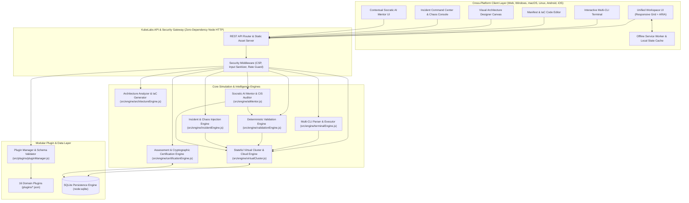
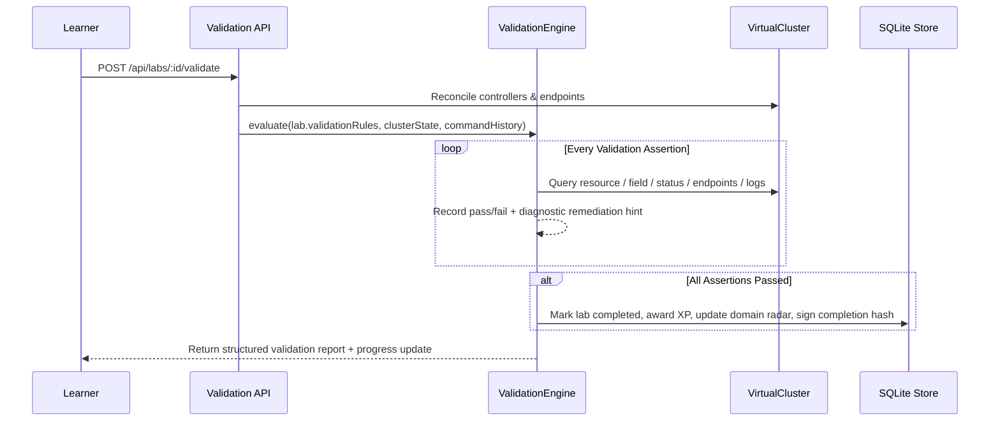
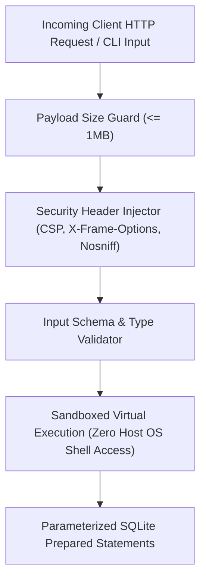
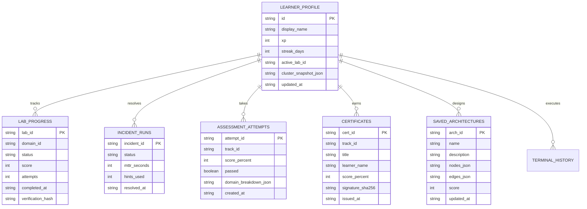
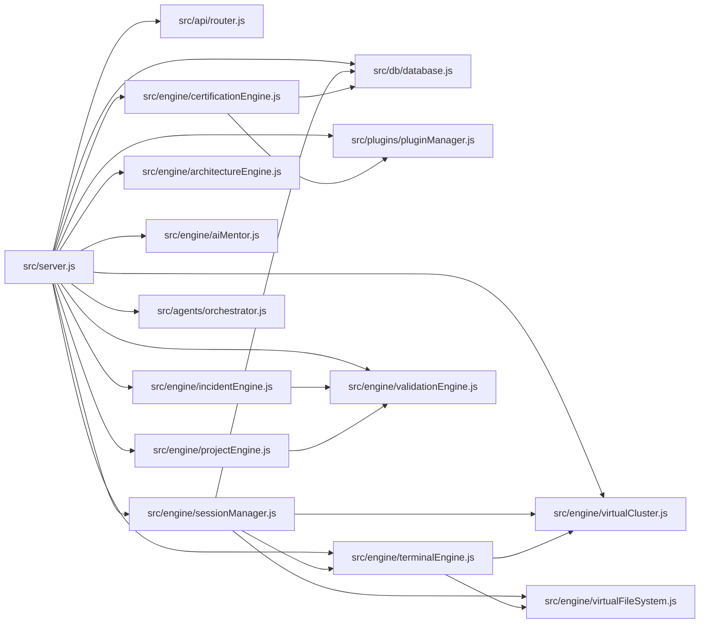
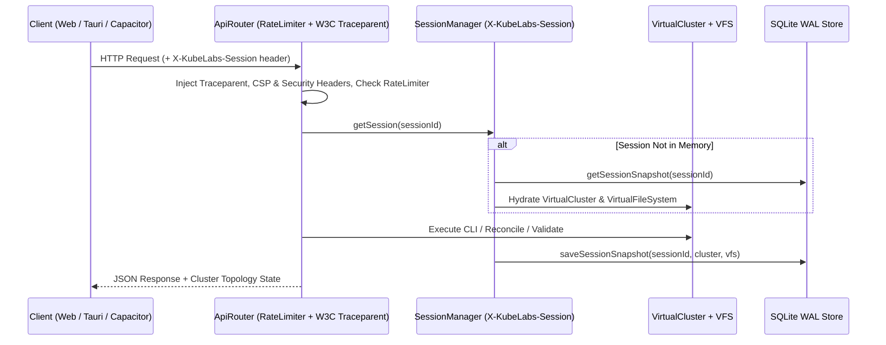

# System, Component, Security, Data & Lab Architecture

**Document ID**: ARCH-KUBELABS-2026-001  
**Version**: 1.0.0  
**Status**: Production Reference

---

## 1. High-Level System Architecture

KubeLabs employs a **Dual-Mode Hybrid Execution Architecture**:
1. **Local Full-Stack Server Mode** (Node.js HTTP Server + `node:sqlite` + Stateful Virtual Cluster Engine) for desktop, CLI, container, and self-hosted deployments.
2. **Offline Client-Side Mirror Mode** (Service Worker + In-Browser State Synchronizer) enabling seamless operation on mobile devices (Android/iOS PWA) or disconnected environments.

---

## 2. Component Architecture

### 2.1 Stateful Virtual Cluster & Cloud Engine (`src/engine/virtualCluster.js`)
Rather than spinning up a 4GB RAM virtual machine for every lab, KubeLabs implements a deterministic **In-Memory + SQLite-Persisted Control Plane & Controller Manager**:
- **Resource Store**: Indexed by `apiVersion`, `kind`, `metadata.namespace`, and `metadata.name`.
- **Reconciliation Loop (`reconcile()`)**:
  - **Deployment Controller**: Automatically creates/updates child `ReplicaSet` and `Pod` objects matching `.spec.replicas` and `.spec.template`.
  - **Scheduler Simulator**: Evaluates Pod CPU/Memory requests against Node allocatable capacity, `nodeSelector`, and `taints`/`tolerations`. Sets Pod status to `Running`, `Pending` (`0/3 nodes are available: Insufficient cpu/memory`), `ImagePullBackOff` (when image tag is invalid/broken), `CrashLoopBackOff` (when command/env/secret reference fails), or `OOMKilled`.
  - **EndpointSlice Controller**: Evaluates `Service.spec.selector` against running Pods in the same namespace. Populates live endpoints (`10.244.x.y:port`) or leaves `0 endpoints` when labels mismatch.
  - **NetworkPolicy Evaluator**: Computes ingress/egress allow matrices between pods across namespaces.
  - **Cloud & IaC State Graph**: Tracks OpenTofu/Terraform resources (`aws_eks_cluster`, `aws_s3_bucket`, `azurerm_kubernetes_cluster`, `google_container_cluster`), Helm releases, Argo CD `Application` sync/health status, Istio `VirtualService`/`DestinationRule` traffic weights, and Prometheus alerts.

### 2.2 Multi-CLI Terminal Engine (`src/engine/terminalEngine.js`)
Parses command lines with support for flags (`-n`, `--namespace`, `-o`, `-l`, `--replicas`, `-f`), pipes (`| grep`), and heredocs/inline manifests.
- Supported binaries: `kubectl`, `helm`, `docker`, `crictl`, `argocd`, `istioctl`, `tofu`, `terraform`, `aws`, `az`, `gcloud`, `trivy`, `falco`, `cosign`, `aiops`, `ls`, `cat`, `grep`, `ps`, `top`, `df`, `free`, `ip`, `ss`, `ping`, `curl`, `dig`, `nslookup`, `systemctl`, `journalctl`, `uname`, `whoami`, `id`, `help`, `clear`.

### 2.3 Deterministic Validation Engine (`src/engine/validationEngine.js`)
Executes a declarative list of validation checks defined in each lab or incident scenario:

### 2.4 Incident Simulation Engine (`src/engine/incidentEngine.js`)
Injects multi-layered production faults into the virtual cluster and tracks learner diagnostic workflow and Mean Time To Recovery (MTTR):
- **Fault Types**: Bad container image rollout, missing Secret/ConfigMap key causing `CrashLoopBackOff`, Service selector mismatch causing 503 Bad Gateway, restrictive `NetworkPolicy` blocking database egress, CoreDNS upstream misconfiguration, Istio `DestinationRule` mTLS conflict, Pod memory limit `OOMKilled`, Terraform production drift.

### 2.5 Visual Architecture Designer Engine (`src/engine/architectureEngine.js`)
Manages node-and-edge cloud-native topologies:
- Translates visual nodes (`ingress`, `waf`, `service`, `deployment`, `statefulset`, `database`, `cache`, `mesh`, `gitops`, `observability`, `iac`, `cloud-vpc`, `gpu-pool`) into valid Kubernetes YAML and OpenTofu HCL.
- Performs automated **Well-Architected Review** across 5 pillars: Reliability, Security, Operational Excellence, Performance Efficiency, and Cost Optimization.

---

## 3. Security Architecture

- **Isolation Boundary**: User terminal commands are tokenized and executed strictly against the in-memory/SQLite virtual cluster state tree. No child process (`child_process.exec` or `spawn`) is ever invoked from user input.
- **Cryptographic Verification**: Exam and lab completion certificates are signed with HMAC-SHA256 using `node:crypto` so learners and employers can verify authenticity.

---

## 4. Data Architecture & Schema (`src/db/database.js`)

KubeLabs uses Node's built-in `node:sqlite` (`DatabaseSync`) with WAL mode enabled for high concurrency and zero external dependencies:

---

## 5. Modular Plugin Architecture (`schemas/plugin.schema.json`)

Every curriculum domain is packaged as a self-contained, schema-validated JSON plugin under `plugins/<domain-id>.json`. Adding a new technology (e.g., WebAssembly on Kubernetes, Quantum Cloud, eBPF Cilium Tetragon) requires **zero changes** to the core platform—simply drop a compliant JSON plugin into `plugins/`.

Each plugin defines:
- `id`, `title`, `category`, `version`, `icon`, `difficulty`, `estimatedHours`
- `prerequisites`: Array of domain IDs
- `learningObjectives`: Measurable outcomes
- `curriculumModules`: Deep theoretical and architectural lessons with production patterns
- `labs`: Interactive hands-on labs with `initialClusterState`, `starterManifest`, `steps`, `validationRules`, `solutionCommands`, `troubleshootingHint`, and `productionScenario`
- `assessmentQuestions`: Scenario and performance-based questions for certification exams

---

## 6. Module Dependency, API-Flow & Data-Flow Diagrams

### 6.1 Module Dependency Graph

### 6.2 Multi-Tenant Session & Offline Sync Data-Flow

