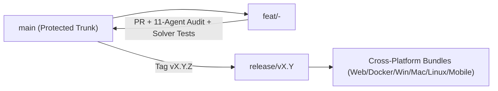

# GitHub Organization, Repository Structure, Branching Strategy & CI/CD

**Document ID**: DEVOPS-KUBELABS-2026-001  
**Version**: 1.0.0

---

## 1. GitHub Organization & Governance

### 1.1 Organization Topology (`github.com/kubelabs-io`)
- **`kubelabs`** (Primary Monorepo — Engine, Web/PWA Client, 16 Core Plugins, Docs, Agent Framework, CI/CD)
- **`kubelabs-community-plugins`** (Community-contributed curriculum plugins validated by `schemas/plugin.schema.json`)
- **`kubelabs-desktop-mobile`** (Electron/Tauri Desktop & Capacitor Android/iOS packaging wrappers consuming the core bundle)

### 1.2 Team Roles & CODEOWNERS Mapping
| GitHub Team | Responsibility | Protected Paths |
|---|---|---|
| `@kubelabs-io/architecture` | Core simulation engines, ADRs, schemas | `src/engine/`, `schemas/`, `docs/03-*`, `docs/04-*` |
| `@kubelabs-io/curriculum` | Domain plugins, labs, incidents, exams | `plugins/`, `docs/07-*` |
| `@kubelabs-io/frontend` | Cross-platform UI, terminal, designer canvas, PWA | `public/` |
| `@kubelabs-io/security` | Security middleware, CI scans, GEC compliance | `.github/workflows/`, `src/api/`, `scripts/self-audit.js` |
| `@kubelabs-io/platform` | Persistence, performance budgets, release engineering | `src/db/`, `src/server.js`, `package.json` |

---

## 2. Monorepo Directory Structure

```text
kubelabs/
├── .github/
│   ├── CODEOWNERS
│   ├── PULL_REQUEST_TEMPLATE.md
│   └── workflows/
│       ├── ci.yml                  # Continuous Integration, Solver Verification & Self-Audit
│       ├── release.yml             # Cross-Platform Release & Artifact Attestation
│       └── security-scan.yml       # SAST, Secret Detection & Zero-CVE Supply Chain Audit
├── agents/
│   └── AGENT-FRAMEWORK.md          # Specifications, prompts & gates for all 11 Engineering Agents
├── docs/
│   ├── 01-GLOBAL-ENGINEERING-CONTRACT.md
│   ├── 02-PRD.md
│   ├── 03-ARCHITECTURE.md
│   ├── 04-ADRS.md
│   ├── 05-GITHUB-AND-CICD.md
│   ├── 06-IMPLEMENTATION-PLAN.md
│   ├── 07-CURRICULUM-CATALOG.md
│   └── 08-OPERATIONS-AND-RUNBOOKS.md
├── plugins/                        # 16 Modular Domain Plugins (Schema-Validated)
│   ├── 01-linux-fundamentals.json
│   ├── 02-containers-runtime.json
│   ├── 03-cloud-networking.json
│   ├── 04-kubernetes-core.json
│   ├── 05-cncf-packaging.json
│   ├── 06-gitops-delivery.json
│   ├── 07-devops-cicd.json
│   ├── 08-devsecops-security.json
│   ├── 09-service-mesh.json
│   ├── 10-observability-stack.json
│   ├── 11-sre-incident-chaos.json
│   ├── 12-platform-engineering.json
│   ├── 13-iac-opentofu-terraform.json
│   ├── 14-cloud-aws.json
│   ├── 15-cloud-azure-gcp.json
│   └── 16-aiops-autonomous.json
├── public/                         # Cross-Platform Web/PWA/Desktop/Mobile Frontend
│   ├── index.html
│   ├── manifest.json
│   ├── sw.js
│   ├── css/
│   │   └── styles.css
│   └── js/
│       └── app.js
├── schemas/
│   └── plugin.schema.json          # Strict JSON Schema for Curriculum Plugins
├── scripts/
│   └── self-audit.js               # Automated 10-Stage Quality Gate & Self-Audit Runner
├── src/
│   ├── server.js                   # Production HTTP Server & CLI Entrypoint
│   ├── agents/
│   │   └── orchestrator.js         # 11-Agent Framework Verification Engine
│   ├── api/
│   │   └── router.js               # REST API Gateway & Security Middleware
│   ├── db/
│   │   └── database.js             # SQLite Persistence Engine (node:sqlite)
│   ├── engine/
│   │   ├── virtualCluster.js       # Stateful Kubernetes & Cloud-Native Simulation Engine
│   │   ├── terminalEngine.js       # Sandboxed Multi-CLI Parser & Executor
│   │   ├── validationEngine.js     # Deterministic Multi-Assertion Lab Validator
│   │   ├── incidentEngine.js       # Production Outage & Chaos Simulation Engine
│   │   ├── architectureEngine.js   # Visual Architecture Designer & IaC Generator
│   │   ├── aiMentor.js             # Socratic AI Mentor & CIS Benchmark Auditor
│   │   └── certificationEngine.js  # Performance Exams & Cryptographic Certificates
│   └── plugins/
│       └── pluginManager.js        # Dynamic Plugin Loader & Schema Validator
├── tests/
│   └── kubelabs.test.js            # Comprehensive Unit, API, Security & Lab Solver Test Suite
└── package.json
```

---

## 3. Branching & Release Strategy

KubeLabs follows **Trunk-Based Development with Automated Release Branches**:



1. **`main` Branch**: Always deployable. Direct pushes are blocked. Requires:
   - Passing `ci.yml` across Ubuntu, Windows, and macOS runners.
   - `100%` lab solver verification (`npm test`).
   - `0` violations in `npm run audit:self`.
2. **Short-Lived Feature Branches**:
   - `feat/<scope>-<description>`
   - `fix/<scope>-<description>`
   - `plugin/<domain-id>`
   - `docs/<topic>`
3. **Commit Convention**: Conventional Commits (`feat:`, `fix:`, `docs:`, `test:`, `sec:`, `perf:`).

---

## 4. CI/CD Pipeline Architecture (`.github/workflows/`)

- **`ci.yml`**: Runs on every push and PR across `ubuntu-latest`, `windows-latest`, and `macos-latest`:
  1. Checkout repository
  2. Setup Node.js `22.x` (LTS)
  3. Execute Self-Audit & 11-Agent Quality Gate (`npm run audit:self`)
  4. Execute Full Unit, Integration, Security, and E2E Lab Solver Suite (`npm test`)
- **`security-scan.yml`**: Runs on push, PR, and daily schedule:
  1. Verifies zero third-party runtime dependencies in `package.json`
  2. Scans for hardcoded secrets, tokens, or unsafe `child_process` invocations
  3. Verifies HTTP security headers and SQL parameterization
- **`release.yml`**: Triggered on `v*.*.*` tags:
  1. Runs full verification matrix
  2. Generates cross-platform standalone distribution archive and SHA-256 checksums

