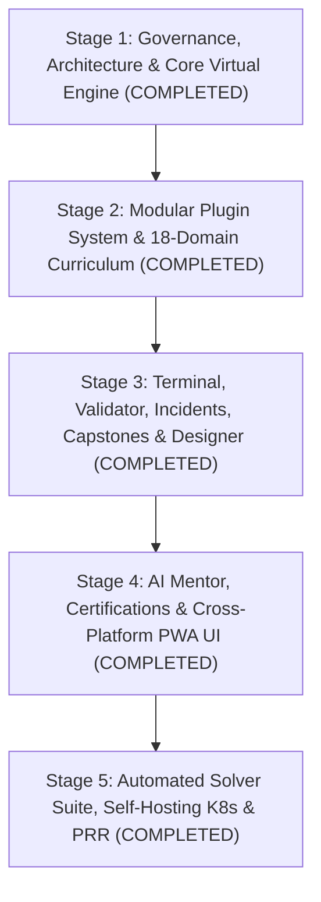

# Phased Implementation Plan & Subphase Execution Ledger

**Document ID**: PLAN-KUBELABS-2026-001  
**Governance**: Every Stage, Phase, and Subphase delivers a complete, independently validated project capability passing all 10 lifecycle checks (`Requirements → Design → Architecture → Implementation → Tests → Documentation → Validation → Security Review → Performance Review → Production Readiness Review`).

---

---

## Stage 1: Foundation, Governance & Stateful Virtual Cluster Engine
**Delivered Capability**: Validated engineering governance, SQLite persistence layer, and a working stateful Kubernetes & Cloud-Native virtual control plane with controller reconciliation.

- **Phase 1.1: Engineering Contract & Architectural Blueprints**
  - [x] **Subphase 1.1.1**: Author Global Engineering Contract ([01-GLOBAL-ENGINEERING-CONTRACT.md](file:///h:/kubelabs/docs/01-GLOBAL-ENGINEERING-CONTRACT.md)), DoR/DoD, and Quality Gates.
  - [x] **Subphase 1.1.2**: Author PRD ([02-PRD.md](file:///h:/kubelabs/docs/02-PRD.md)), System/Security/Data Architecture ([03-ARCHITECTURE.md](file:///h:/kubelabs/docs/03-ARCHITECTURE.md)), and ADRs ([04-ADRS.md](file:///h:/kubelabs/docs/04-ADRS.md)).
  - [x] **Subphase 1.1.3**: Define 11-Agent Framework ([AGENT-FRAMEWORK.md](file:///h:/kubelabs/agents/AGENT-FRAMEWORK.md)) and automated orchestrator ([orchestrator.js](file:///h:/kubelabs/src/agents/orchestrator.js)).
- **Phase 1.2: SQLite Persistence Layer ([database.js](file:///h:/kubelabs/src/db/database.js))**
  - [x] **Subphase 1.2.1**: Initialize `node:sqlite` (`DatabaseSync`) with WAL mode and schema migrations.
  - [x] **Subphase 1.2.2**: Implement parameterized CRUD repositories for Learner Profile, Lab Progress, Incidents, Projects, Assessments, Certificates, and Saved Architectures.
- **Phase 1.3: Stateful Virtual Cluster & Cloud Engine ([virtualCluster.js](file:///h:/kubelabs/src/engine/virtualCluster.js))**
  - [x] **Subphase 1.3.1**: Build YAML/JSON manifest parser and multi-namespace resource graph (`Node`, `Namespace`, `Pod`, `Deployment`, `ReplicaSet`, `Service`, `Ingress`, `NetworkPolicy`, `ConfigMap`, `Secret`, `PersistentVolumeClaim`, `ServiceAccount`, `Role`, `RoleBinding`, `HorizontalPodAutoscaler`, CRDs).
  - [x] **Subphase 1.3.2**: Implement Controller Manager reconciliation loop (`Deployment -> ReplicaSet -> Pods`, `EndpointSlice` binding, Scheduler capacity & taint/toleration checks, error state simulation for `ImagePullBackOff`, `CrashLoopBackOff`, `OOMKilled`, `Pending`).
  - [x] **Subphase 1.3.3**: Implement Cloud & CNCF state extensions (Helm releases, Argo CD Applications, Istio VirtualServices/DestinationRules/PeerAuthentication, OpenTofu/Terraform resources, AWS/Azure/GCP resources, AI-Ops telemetry).

---

## Stage 2: Modular Plugin Architecture & 18-Domain Curriculum
**Delivered Capability**: Schema-validated plugin engine dynamically loading all 18 cloud-native & emerging technology domains, 6 guided learning paths, 36 hands-on labs, and deterministic validation rules.

- **Phase 2.1: Plugin Schema & Loader ([plugin.schema.json](file:///h:/kubelabs/schemas/plugin.schema.json), [pluginManager.js](file:///h:/kubelabs/src/plugins/pluginManager.js))**
  - [x] **Subphase 2.1.1**: Define strict JSON schema for plugins, modules, labs, validation rules, and exam questions.
  - [x] **Subphase 2.1.2**: Build `PluginManager` with automatic discovery, schema validation, dependency graph resolution, and learning path generation.
- **Phase 2.2: Core Infrastructure & Kubernetes Plugins (Domains 01–08)**
  - [x] **Subphase 2.2.1**: Author and validate [01-linux-fundamentals.json](file:///h:/kubelabs/plugins/01-linux-fundamentals.json), [02-containers-runtime.json](file:///h:/kubelabs/plugins/02-containers-runtime.json), [03-cloud-networking.json](file:///h:/kubelabs/plugins/03-cloud-networking.json), and [04-kubernetes-core.json](file:///h:/kubelabs/plugins/04-kubernetes-core.json).
  - [x] **Subphase 2.2.2**: Author and validate [05-cncf-packaging.json](file:///h:/kubelabs/plugins/05-cncf-packaging.json), [06-gitops-delivery.json](file:///h:/kubelabs/plugins/06-gitops-delivery.json), [07-devops-cicd.json](file:///h:/kubelabs/plugins/07-devops-cicd.json), and [08-devsecops-security.json](file:///h:/kubelabs/plugins/08-devsecops-security.json).
- **Phase 2.3: Advanced SRE, Platform, Multi-Cloud, AI-Ops & Emerging Tech Plugins (Domains 09–18)**
  - [x] **Subphase 2.3.1**: Author and validate [09-service-mesh.json](file:///h:/kubelabs/plugins/09-service-mesh.json), [10-observability-stack.json](file:///h:/kubelabs/plugins/10-observability-stack.json), [11-sre-incident-chaos.json](file:///h:/kubelabs/plugins/11-sre-incident-chaos.json), and [12-platform-engineering.json](file:///h:/kubelabs/plugins/12-platform-engineering.json).
  - [x] **Subphase 2.3.2**: Author and validate [13-iac-opentofu-terraform.json](file:///h:/kubelabs/plugins/13-iac-opentofu-terraform.json), [14-cloud-aws.json](file:///h:/kubelabs/plugins/14-cloud-aws.json), [15-cloud-azure-gcp.json](file:///h:/kubelabs/plugins/15-cloud-azure-gcp.json), and [16-aiops-autonomous.json](file:///h:/kubelabs/plugins/16-aiops-autonomous.json).
  - [x] **Subphase 2.3.3**: Author and validate emerging technology plugins [17-wasm-ebpf-edge.json](file:///h:/kubelabs/plugins/17-wasm-ebpf-edge.json) (WebAssembly SpinKube & Cilium Tetragon eBPF) and [18-finops-green-cloud.json](file:///h:/kubelabs/plugins/18-finops-green-cloud.json) (CNCF OpenCost FinOps & Kepler Sustainable Computing).

---

## Stage 3: Multi-CLI Terminal, Validation Engine, Incident Simulator, Capstone Projects & Architecture Designer
**Delivered Capability**: Complete interactive lab execution, production outage troubleshooting simulator, 6 multi-milestone real-world capstone projects, and visual architecture designer with YAML/HCL code generation.

- **Phase 3.1: Sandboxed Multi-CLI Terminal Engine ([terminalEngine.js](file:///h:/kubelabs/src/engine/terminalEngine.js))**
  - [x] **Subphase 3.1.1**: Implement command parser supporting flags, pipes (`| grep`), output modes (`-o wide|yaml|json`), and inline manifests.
  - [x] **Subphase 3.1.2**: Implement executors for `kubectl`, `helm`, `docker`, `linux`/`net`, `argocd`, `istioctl`, `tofu`/`terraform`, `aws`/`az`/`gcloud`, `trivy`/`falco`/`cosign`, and `aiops`.
- **Phase 3.2: Deterministic Multi-Assertion Validation Engine ([validationEngine.js](file:///h:/kubelabs/src/engine/validationEngine.js))**
  - [x] **Subphase 3.2.1**: Implement assertion evaluators (`resource_exists`, `resource_field_equals`, `resource_field_contains`, `pod_status_running`, `service_has_endpoints`, `command_executed`, `replica_count_min`, `cloud_resource_exists`, `helm_release_deployed`, `argocd_app_synced`).
  - [x] **Subphase 3.2.2**: Generate detailed pass/fail telemetry and cryptographic completion hashes.
- **Phase 3.3: Incident Simulation & Chaos Engine ([incidentEngine.js](file:///h:/kubelabs/src/engine/incidentEngine.js))**
  - [x] **Subphase 3.3.1**: Author 8 production-grade outage scenarios across Kubernetes, DNS/Service selectors, NetworkPolicy, GitOps drift, GPU taints, and OOM/CPU starvation.
  - [x] **Subphase 3.3.2**: Implement live fault injection, symptom telemetry, MTTR timer, and automated recovery verification.
- **Phase 3.4: UI Architecture Designer & Reference Architectures ([architectureEngine.js](file:///h:/kubelabs/src/engine/architectureEngine.js))**
  - [x] **Subphase 3.4.1**: Build topology graph analyzer scoring Reliability, Security, Observability, and Operational Excellence, plus SPOF detection.
  - [x] **Subphase 3.4.2**: Build Kubernetes YAML and OpenTofu HCL compiler from visual topologies and load 8 Enterprise Reference Architectures.
- **Phase 3.5: Real-World Production Capstone Projects Engine ([projectEngine.js](file:///h:/kubelabs/src/engine/projectEngine.js))**
  - [x] **Subphase 3.5.1**: Author 6 multi-milestone production capstone projects spanning all 6 role career tracks.
  - [x] **Subphase 3.5.2**: Implement deterministic milestone validation and guided project solver verification.

---

## Stage 4: Socratic AI Mentor, Certifications & Cross-Platform Offline-Ready UI
**Delivered Capability**: Full-featured responsive Web/PWA/Desktop/Mobile application with Socratic AI coaching, hands-on exams, and verifiable certificates.

- **Phase 4.1: Contextual Socratic AI Mentor ([aiMentor.js](file:///h:/kubelabs/src/engine/aiMentor.js))**
  - [x] **Subphase 4.1.1**: Build live cluster state diff analyzer & error pattern matcher for Socratic hints and root-cause debugging.
  - [x] **Subphase 4.1.2**: Build automated CIS Kubernetes Security Benchmark auditor.
- **Phase 4.2: Assessment & Certification Engine ([certificationEngine.js](file:///h:/kubelabs/src/engine/certificationEngine.js))**
  - [x] **Subphase 4.2.1**: Build 6 role-based certification tracks combining domain questions and mastery radar calculation.
  - [x] **Subphase 4.2.2**: Generate HMAC-SHA256 signed certificates and verification API.
- **Phase 4.3: Cross-Platform Web/PWA/Mobile Frontend ([public/](file:///h:/kubelabs/public/index.html))**
  - [x] **Subphase 4.3.1**: Build responsive workspace UI ([index.html](file:///h:/kubelabs/public/index.html), [styles.css](file:///h:/kubelabs/public/css/styles.css), [app.js](file:///h:/kubelabs/public/js/app.js)) with Guided Paths, Capstone Projects, Interactive Lab Workbench, Incident Command Center, Visual Architecture Designer, Certifications, and AI Mentor.
  - [x] **Subphase 4.3.2**: Implement offline Service Worker ([sw.js](file:///h:/kubelabs/public/sw.js)) and PWA manifest ([manifest.json](file:///h:/kubelabs/public/manifest.json)).

---

## Stage 5: Automated Solver Verification, CI/CD, Self-Hosting Packaging & Production Readiness Review
**Delivered Capability**: 100% verified, security-hardened, self-audited, container/Kubernetes-packaged production repository.

- **Phase 5.1: Automated Testing & Lab/Project/Incident Solver Verification ([kubelabs.test.js](file:///h:/kubelabs/tests/kubelabs.test.js))**
  - [x] **Subphase 5.1.1**: Write unit & integration tests covering all engines and REST API routes.
  - [x] **Subphase 5.1.2**: Write automated E2E Solver Tests that iterate over all 36 labs, 8 incidents, and 6 capstone projects, verifying initial state fails validation and canonical solution commands achieve 100% pass.
- **Phase 5.2: Self-Audit, CI/CD Workflows & Self-Hosting Packaging**
  - [x] **Subphase 5.2.1**: Implement [self-audit.js](file:///h:/kubelabs/scripts/self-audit.js) and [verify-subphases.js](file:///h:/kubelabs/scripts/verify-subphases.js) running all 11 Agent quality gates and verifying all 29 subphases individually.
  - [x] **Subphase 5.2.2**: Author GitHub Actions workflows ([ci.yml](file:///h:/kubelabs/.github/workflows/ci.yml), [release.yml](file:///h:/kubelabs/.github/workflows/release.yml), [security-scan.yml](file:///h:/kubelabs/.github/workflows/security-scan.yml)) and operational runbooks ([08-OPERATIONS-AND-RUNBOOKS.md](file:///h:/kubelabs/docs/08-OPERATIONS-AND-RUNBOOKS.md)).
  - [x] **Subphase 5.2.3**: Author rootless [Dockerfile](file:///h:/kubelabs/Dockerfile), [docker-compose.yml](file:///h:/kubelabs/docker-compose.yml), self-hosting Kubernetes manifests ([kubelabs-k8s.yaml](file:///h:/kubelabs/deploy/kubernetes/kubelabs-k8s.yaml)), STRIDE Threat Model ([09-SECURITY-AND-THREAT-MODEL.md](file:///h:/kubelabs/docs/09-SECURITY-AND-THREAT-MODEL.md)), and Performance Benchmarks ([10-PERFORMANCE-AND-SCALABILITY-BENCHMARKS.md](file:///h:/kubelabs/docs/10-PERFORMANCE-AND-SCALABILITY-BENCHMARKS.md)).
