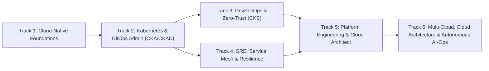

# Master Curriculum Catalog & Learning Path Matrix

**Document ID**: CURR-KUBELABS-2026-001  
**Version**: 4.0.0 (Full-Stack Transformation Edition)  
**Coverage**: 45 Domains | 7 Tiers | 6 Guided Role Tracks | 90 Hands-On Labs | 25 Live Production Incident Simulations | 8 Production Capstone Projects (26 Milestones) | 8 Enterprise Reference Architectures | 6 Verifiable Performance Certification Simulators

---

## 1. Guided Role Learning Paths

| Track ID | Role Title | Primary Focus | Performance Certification Simulator |
|---|---|---|---|
| `track-foundations` | Cloud-Native Systems Engineer | Linux, Cgroups v2, Containers, Networking, Git | `perf-exam-kcna` (KCNA-SIM, 60m, 4 tasks) |
| `track-k8s-admin` | Kubernetes & GitOps Administrator | Kubernetes Core, CKA/CKAD, Helm, GitOps, CI/CD | `perf-exam-cka` (CKA-SIM, 120m, 5 tasks) |
| `track-devsecops` | DevSecOps & Zero-Trust Specialist | CKS Security, Policy-as-Code, Tetragon, SPIFFE | `perf-exam-cks` (CKS-SIM, 120m, 5 tasks) |
| `track-sre` | Principal SRE & Chaos Engineer | Observability, SLOs, Prometheus, Chaos, KEDA | `perf-exam-ckre` (CKRE-SIM, 90m, 4 tasks) |
| `track-platform` | Platform Engineering & Architect | IDP, Backstage, Crossplane, OpenTofu, CAPI, Arch | `perf-exam-cpa` (CPA-SIM, 90m, 4 tasks) |
| `track-multicloud-aiops` | Multi-Cloud & AI-Ops Principal | Multi-Cloud, CQRS, C4, GPU Serving & AI-Ops | `perf-exam-cmaos` (CMAOS-SIM, 90m, 4 tasks) |

---

## 2. 7-Tier Curriculum Specification (Domains 01–45 & 90 Labs)

### Tier 1: Linux & OS Foundations

#### Domain 01: Linux Fundamentals & Command-Line Streaming Pipelines (`linux-fundamentals`)

- **Track**: `track-foundations` | **Category**: Foundations | **Difficulty**: Beginner
- **Prerequisites**: None
- **Summary**: Master Linux POSIX filesystem navigation, file permissions (octal and symbolic), ownership, stream redirections, and multi-stage text processing pipelines with grep, sed, awk, cut, and sort.
- **Interactive Hands-On Labs (2)**:
  1. `lab-linux-01-permissions`: **Linux Filesystem Permissions & Security Hardening** — Hands-on deterministic terminal scenario.
  2. `lab-linux-01-text-pipelines`: **POSIX Streaming Pipelines & Access Log Analysis** — Hands-on deterministic terminal scenario.

#### Domain 02: Linux Administration, Cgroups v2 & Systemd Internals (`linux-admin`)

- **Track**: `track-foundations` | **Category**: Foundations | **Difficulty**: Intermediate
- **Prerequisites**: linux-fundamentals
- **Summary**: Master Linux systemd service lifecycles, journalctl log diagnostics, cgroups v2 resource accounting, kernel namespaces isolation, sysctl network tuning, and LVM storage volume management.
- **Interactive Hands-On Labs (2)**:
  1. `lab-linux-02-systemd-cgroups`: **Systemd Unit Lifecycle, Journalctl Diagnostics & Cgroups v2 Throttling** — Hands-on deterministic terminal scenario.
  2. `lab-linux-02-namespaces-sysctl`: **Linux Kernel Namespaces Isolation, Sysctl Tuning & LVM Volume Provisioning** — Hands-on deterministic terminal scenario.

#### Domain 03: Linux Networking Fundamentals, Bridge Isolation & Packet Filtering (`networking-fundamentals`)

- **Track**: `track-foundations` | **Category**: Foundations | **Difficulty**: Beginner
- **Prerequisites**: linux-fundamentals, linux-admin
- **Summary**: Master Linux networking foundations including software bridges (br0), virtual ethernet pairs (veth), network namespace isolation, default gateway routing, iptables NAT masquerading, and CoreDNS/TLS diagnostics.
- **Interactive Hands-On Labs (2)**:
  1. `lab-net-01-veth-bridge`: **Linux Bridge, Veth Pairs & Namespace Network Isolation** — Hands-on deterministic terminal scenario.
  2. `lab-net-02-iptables-nat-tls`: **Iptables NAT Masquerade, CoreDNS & TLS Certificate Inspection** — Hands-on deterministic terminal scenario.

#### Domain 04: Git Internals, Content-Addressable Storage, DAG & History Rewriting (`git-fundamentals`)

- **Track**: `track-foundations` | **Category**: Foundations | **Difficulty**: Beginner
- **Prerequisites**: linux-fundamentals
- **Summary**: Master Git internals from content-addressable object databases (blobs, trees, commits, tags) to branch merging, cherry-picking, interactive rebasing, bisect debugging, reflog recovery, and GPG commit verification.
- **Interactive Hands-On Labs (2)**:
  1. `lab-git-01-internals`: **Git Plumbing: Object Database, Hashing & Tree Inspection** — Hands-on deterministic terminal scenario.
  2. `lab-git-02-rebase-reflog-cherrypick`: **Git Advanced Workflows: Cherry-Pick, Rebase, Bisect & Reflog Recovery** — Hands-on deterministic terminal scenario.

### Tier 2: Container Runtime & Packaging

#### Domain 05: Docker & OCI Container Engineering (`docker-containers`)

- **Track**: `track-foundations` | **Category**: Containers & Packaging | **Difficulty**: Intermediate
- **Prerequisites**: linux-fundamentals, linux-admin
- **Summary**: Master Docker containerization, multi-stage distroless builds, non-root user execution, OCI layer caching, OverlayFS storage drivers, and rootless daemon security architecture.
- **Interactive Hands-On Labs (2)**:
  1. `lab-docker-01-multistage-distroless`: **Hardening Microservices with Multi-Stage Distroless Builds** — Hands-on deterministic terminal scenario.
  2. `lab-docker-02-overlayfs-storage`: **OverlayFS Storage Driver, Layer Inspection & Garbage Collection** — Hands-on deterministic terminal scenario.

#### Domain 06: OCI Container Runtimes & CRI Architecture (`container-runtime-cri`)

- **Track**: `track-foundations` | **Category**: Containers & Packaging | **Difficulty**: Intermediate
- **Prerequisites**: docker-containers, linux-admin
- **Summary**: Master the Kubernetes Container Runtime Interface (CRI), containerd daemon configuration, low-level OCI runtimes (runc vs gVisor sandboxes), and cri-tools (crictl) node diagnostics.
- **Interactive Hands-On Labs (2)**:
  1. `lab-cri-01-crictl-diagnostics`: **Worker Node Pod Sandbox & Container Diagnostics with crictl** — Hands-on deterministic terminal scenario.
  2. `lab-cri-02-sandboxed-runtimes`: **Securing Untrusted Workloads with gVisor Sandboxed RuntimeClass** — Hands-on deterministic terminal scenario.

#### Domain 07: Helm v3 Application Packaging & Release Lifecycle (`helm-packaging`)

- **Track**: `track-k8s-admin` | **Category**: Containers & Packaging | **Difficulty**: Intermediate
- **Prerequisites**: docker-containers, container-runtime-cri
- **Summary**: Master cloud-native application packaging using Helm v3, Go template syntax, named template helpers (_helpers.tpl), subchart dependencies, lifecycle hooks, helm test, and atomic rollback strategies.
- **Interactive Hands-On Labs (2)**:
  1. `lab-helm-01-chart-templating`: **Authoring Modular Helm Charts with Helpers & Go Templates** — Hands-on deterministic terminal scenario.
  2. `lab-helm-02-lifecycle-rollback-test`: **Helm Release Lifecycle: Atomic Upgrades, Helm Test & Rollbacks** — Hands-on deterministic terminal scenario.

#### Domain 08: Kustomize Declarative Configuration Management (`kustomize-manifests`)

- **Track**: `track-k8s-admin` | **Category**: Containers & Packaging | **Difficulty**: Intermediate
- **Prerequisites**: helm-packaging, docker-containers
- **Summary**: Master template-free Kubernetes configuration management using Kustomize, base and multi-environment overlays, strategic merge patches, JSON 6902 patches, and configMapGenerator hash suffixes.
- **Interactive Hands-On Labs (2)**:
  1. `lab-kust-01-overlays-patching`: **Multi-Environment Overlay Architecture & Strategic Merge Patches** — Hands-on deterministic terminal scenario.
  2. `lab-kust-02-generators-jsonpatch`: **ConfigMap Generators, Secret Generators & Rollout Synchronization** — Hands-on deterministic terminal scenario.

### Tier 3: Kubernetes Core & Certification Track

#### Domain 09: Kubernetes Core Architecture, Control Plane & RBAC (`kubernetes-core-v4`)

- **Track**: `track-k8s-admin` | **Category**: Kubernetes & CNCF | **Difficulty**: Intermediate
- **Prerequisites**: kustomize-manifests, helm-packaging
- **Summary**: Master core Kubernetes architecture, declarative control plane reconciliation, Deployments, ReplicaSets, ServiceAccounts, least-privilege RBAC Roles, and authorization auditing.
- **Interactive Hands-On Labs (2)**:
  1. `lab-k8s-01-ha-deployments`: **Deploying High-Availability Microservices with Zero-Downtime Rollouts** — Hands-on deterministic terminal scenario.
  2. `lab-k8s-02-rbac-least-privilege`: **Least-Privilege RBAC: ServiceAccount, Role, RoleBinding & Authorization Audit** — Hands-on deterministic terminal scenario.

#### Domain 10: Certified Kubernetes Application Developer (CKAD) Workloads & Patterns (`ckad-developer`)

- **Track**: `track-k8s-admin` | **Category**: Kubernetes & CNCF | **Difficulty**: Intermediate
- **Prerequisites**: kubernetes-core-v4, kustomize-manifests
- **Summary**: Master CKAD core competencies: multi-container Pod patterns (InitContainers, Sidecars, Adapters), container lifecycle health probes (liveness, readiness, startup), batch Jobs, and scheduled CronJobs.
- **Interactive Hands-On Labs (2)**:
  1. `lab-ckad-01-multicontainer-sidecar`: **Multi-Container Pod Patterns: InitContainer Preconditions & Log-Processing Sidecars** — Hands-on deterministic terminal scenario.
  2. `lab-ckad-02-probes-cronjobs`: **Container Health Probes & Scheduled Batch Automations** — Hands-on deterministic terminal scenario.

#### Domain 11: Certified Kubernetes Administrator (CKA) Cluster Operations & Maintenance (`cka-administrator`)

- **Track**: `track-k8s-admin` | **Category**: Kubernetes & CNCF | **Difficulty**: Intermediate
- **Prerequisites**: kubernetes-core-v4, ckad-developer
- **Summary**: Master CKA cluster operations: safe node maintenance (cordon, drain, uncordon, taints), control-plane lifecycle upgrades via kubeadm, and etcd disaster recovery snapshot management.
- **Interactive Hands-On Labs (2)**:
  1. `lab-cka-01-node-maintenance`: **Zero-Downtime Worker Node Maintenance: Cordon, Drain & Taints** — Hands-on deterministic terminal scenario.
  2. `lab-cka-02-etcd-dr-kubeadm`: **Cluster Disaster Recovery & Kubeadm Control-Plane Lifecycle** — Hands-on deterministic terminal scenario.

#### Domain 12: Kubernetes Networking: CNI, Services, Ingress & Gateway API (`k8s-networking`)

- **Track**: `track-k8s-admin` | **Category**: Kubernetes & CNCF | **Difficulty**: Intermediate
- **Prerequisites**: kubernetes-core-v4, networking-fundamentals
- **Summary**: Master cloud-native Kubernetes networking: CNI packet encapsulation, ClusterIP, NodePort, LoadBalancer and Headless Services, CoreDNS discovery, NetworkPolicies, and Gateway API routing.
- **Interactive Hands-On Labs (2)**:
  1. `lab-k8snet-01-cni-services-dns`: **Service Discovery Architecture: ClusterIP, Headless & CoreDNS Endpoints** — Hands-on deterministic terminal scenario.
  2. `lab-k8snet-02-networkpolicy-gateway`: **Zero-Trust NetworkPolicies & Modern Gateway API Route Filtering** — Hands-on deterministic terminal scenario.

#### Domain 13: Kubernetes Storage: CSI, StorageClasses, PVCs & StatefulSets (`k8s-storage`)

- **Track**: `track-k8s-admin` | **Category**: Kubernetes & CNCF | **Difficulty**: Intermediate
- **Prerequisites**: kubernetes-core-v4, ckad-developer
- **Summary**: Master container storage interfaces (CSI): dynamic StorageClass provisioning, volumeBindingMode (WaitForFirstConsumer), access modes (RWO, RWX), PersistentVolumeClaims, and StatefulSets with persistent volumeClaimTemplates.
- **Interactive Hands-On Labs (2)**:
  1. `lab-storage-01-sc-pvc-pv`: **Dynamic Storage Provisioning: StorageClass, PVC & Pod Mounts** — Hands-on deterministic terminal scenario.
  2. `lab-storage-02-statefulset-volume-claims`: **Stateful Workloads: StatefulSet with Ordinal VolumeClaimTemplates** — Hands-on deterministic terminal scenario.

#### Domain 14: Certified Kubernetes Security Specialist (CKS) Hardening & Defense (`k8s-security-cks`)

- **Track**: `track-k8s-admin` | **Category**: Kubernetes & CNCF | **Difficulty**: Intermediate
- **Prerequisites**: kubernetes-core-v4, ckad-developer
- **Summary**: Master CKS security engineering: Pod Security Standards (Privileged, Baseline, Restricted), container securityContext hardening, AppArmor, Seccomp profiles, and Falco runtime behavioral threat detection.
- **Interactive Hands-On Labs (2)**:
  1. `lab-cks-01-pod-security-standards`: **Hardening Workloads with Restricted Pod Security Standards** — Hands-on deterministic terminal scenario.
  2. `lab-cks-02-falco-runtime-security`: **Falco Behavioral Threat Detection & Container Runtime Isolation** — Hands-on deterministic terminal scenario.

#### Domain 15: Kubernetes Troubleshooting: Root Cause Analysis & Outage Remediation (`k8s-troubleshooting`)

- **Track**: `track-k8s-admin` | **Category**: Kubernetes & CNCF | **Difficulty**: Intermediate
- **Prerequisites**: kubernetes-core-v4, ckad-developer
- **Summary**: Master production root cause analysis: diagnose CrashLoopBackOff, ImagePullBackOff, OOMKilled, and restore corrupted static pod control planes and misconfigured Kubelets.
- **Interactive Hands-On Labs (2)**:
  1. `lab-troubleshoot-01-crashloop-oom`: **Diagnosing & Fixing CrashLoopBackOff and OOMKilled Failures** — Hands-on deterministic terminal scenario.
  2. `lab-troubleshoot-02-controlplane-kubelet`: **Control Plane Recovery: Static Pod Manifests & Kubelet Diagnostics** — Hands-on deterministic terminal scenario.

### Tier 4: GitOps, CI/CD & Infrastructure as Code

#### Domain 16: GitOps Principles, Pull-Based Reconciliation & Continuous Delivery (`gitops-delivery`)

- **Track**: `track-k8s-admin` | **Category**: GitOps & Delivery | **Difficulty**: Intermediate
- **Prerequisites**: git-fundamentals, kubernetes-core-v4
- **Summary**: Master GitOps continuous delivery principles: declarative infrastructure, Git as single source of truth, pull-based automated reconciliation, drift detection and self-healing, sealed secrets, and progressive delivery.
- **Interactive Hands-On Labs (2)**:
  1. `lab-gitops-01-pull-reconciliation`: **Pull-Based Reconciliation & Drift Remediation** — Hands-on deterministic terminal scenario.
  2. `lab-gitops-02-secrets-management`: **Declarative Secret Management with ExternalSecrets** — Hands-on deterministic terminal scenario.

#### Domain 17: ArgoCD Enterprise GitOps, ApplicationSets & Sync Waves (`argocd-gitops`)

- **Track**: `track-k8s-admin` | **Category**: GitOps & Delivery | **Difficulty**: Intermediate
- **Prerequisites**: gitops-delivery, kubernetes-core-v4
- **Summary**: Master enterprise GitOps with ArgoCD: Application CRDs, multi-tenant ApplicationSets, declarative sync waves, hooks, health checks, self-healing automated sync, and rollouts integration.
- **Interactive Hands-On Labs (2)**:
  1. `lab-argo-01-app-declarative-sync`: **Deploying and Synchronizing an ArgoCD Application** — Hands-on deterministic terminal scenario.
  2. `lab-argo-02-sync-waves-phased-rollout`: **Phased Rollout Orchestration with ArgoCD Sync Waves** — Hands-on deterministic terminal scenario.

#### Domain 18: FluxCD Multi-Tenancy, Kustomize Controller & HelmReleases (`fluxcd-gitops`)

- **Track**: `track-k8s-admin` | **Category**: GitOps & Delivery | **Difficulty**: Intermediate
- **Prerequisites**: gitops-delivery, helm-packaging, kustomize-manifests
- **Summary**: Master CNCF Graduated FluxCD v2: GitRepository sources, Kustomization reconciliation controllers, declarative HelmReleases, notification controllers, and automated artifact updates.
- **Interactive Hands-On Labs (2)**:
  1. `lab-flux-01-gitrepository-kustomization`: **Configuring Flux GitRepository Source & Kustomization Reconciliation** — Hands-on deterministic terminal scenario.
  2. `lab-flux-02-helmrelease-reconciliation`: **Declarative HelmRelease Management with Flux Helm Controller** — Hands-on deterministic terminal scenario.

#### Domain 19: Cloud-Native CI/CD Pipelines, Tekton & DORA Engineering (`cicd-pipelines`)

- **Track**: `track-k8s-admin` | **Category**: CI/CD & DevSecOps | **Difficulty**: Intermediate
- **Prerequisites**: git-fundamentals, docker-containers, kubernetes-core-v4
- **Summary**: Master cloud-native CI/CD pipelines: declarative Tekton Tasks and Pipelines, workspace volume caching, GitHub Actions workflows, DORA metric instrumentation, and automated container build promotion.
- **Interactive Hands-On Labs (2)**:
  1. `lab-cicd-01-tekton-pipeline`: **Authoring Declarative Tekton Tasks and Pipelines** — Hands-on deterministic terminal scenario.
  2. `lab-cicd-02-github-actions-caching`: **Configuring CI Workflow Build Caching & Artifact Upload** — Hands-on deterministic terminal scenario.

#### Domain 20: DevSecOps Supply Chain Security, SLSA, SBOM & Policy Admission (`devsecops-pipeline`)

- **Track**: `track-devsecops` | **Category**: CI/CD & DevSecOps | **Difficulty**: Intermediate
- **Prerequisites**: cicd-pipelines, k8s-security-cks
- **Summary**: Master DevSecOps pipeline security: Trivy container vulnerability scanning, Software Bill of Materials (SBOM) generation, Cosign digital artifact signing, SLSA supply chain provenance, and Kyverno policy-as-code admission control.
- **Interactive Hands-On Labs (2)**:
  1. `lab-secops-01-trivy-sbom-scan`: **Vulnerability Scanning and Policy Gate with Trivy** — Hands-on deterministic terminal scenario.
  2. `lab-secops-02-kyverno-admission-policy`: **Enforcing Kubernetes Admission Control with Kyverno ClusterPolicy** — Hands-on deterministic terminal scenario.

#### Domain 21: Infrastructure as Code Foundations & Crossplane Control Planes (`iac-foundations`)

- **Track**: `track-platform` | **Category**: Infrastructure as Code | **Difficulty**: Intermediate
- **Prerequisites**: kubernetes-core-v4, k8s-security-cks
- **Summary**: Master modern Infrastructure as Code foundations: Kubernetes-native control planes with Crossplane, CompositeResourceDefinitions (XRDs), Compositions, application claims, and state drift reconciliation.
- **Interactive Hands-On Labs (2)**:
  1. `lab-iac-01-crossplane-xrd`: **Defining a Crossplane CompositeResourceDefinition (XRD)** — Hands-on deterministic terminal scenario.
  2. `lab-iac-02-crossplane-claim`: **Provisioning Cloud Resources with Developer Claims** — Hands-on deterministic terminal scenario.

#### Domain 22: OpenTofu & Terraform Infrastructure Automation, State & Modules (`terraform-opentofu`)

- **Track**: `track-platform` | **Category**: Infrastructure as Code | **Difficulty**: Intermediate
- **Prerequisites**: iac-foundations, git-fundamentals
- **Summary**: Master enterprise infrastructure automation with OpenTofu and Terraform: declarative HCL syntax, provider configurations, remote state locking with S3 and DynamoDB, for_each meta-arguments, resource import, and refactoring with moved blocks.
- **Interactive Hands-On Labs (2)**:
  1. `lab-tofu-01-vpc-cluster-apply`: **Provisioning Cloud Infrastructure with OpenTofu / Terraform** — Hands-on deterministic terminal scenario.
  2. `lab-tofu-02-remote-state-locking`: **Configuring Remote S3 Backend State with DynamoDB Locking** — Hands-on deterministic terminal scenario.

### Tier 5: Service Mesh, Observability & Reliability

#### Domain 23: Service Mesh Architecture, Envoy Proxy & Ambient Data Planes (`service-mesh-core`)

- **Track**: `track-devsecops` | **Category**: Service Mesh & Networking | **Difficulty**: Intermediate
- **Prerequisites**: k8s-networking, kubernetes-core-v4
- **Summary**: Master cloud-native service mesh architecture: sidecar proxy injection vs sidecarless ambient data planes (ztunnel / waypoint), Envoy xDS dynamic configuration APIs (CDS, LDS, EDS, RDS), distributed request tracing, and mesh traffic debugging.
- **Interactive Hands-On Labs (2)**:
  1. `lab-mesh-01-sidecar-injection`: **Enforcing Automated Sidecar Injection and Validating xDS Sync** — Hands-on deterministic terminal scenario.
  2. `lab-mesh-02-mesh-diagnostics`: **Running Automated Mesh Configuration Audits with istioctl analyze** — Hands-on deterministic terminal scenario.

#### Domain 24: Istio Service Mesh Traffic Management, Security & mTLS (`istio-service-mesh`)

- **Track**: `track-devsecops` | **Category**: Service Mesh & Networking | **Difficulty**: Intermediate
- **Prerequisites**: service-mesh-core, k8s-networking
- **Summary**: Master advanced Istio service mesh operations: Ingress Gateways, VirtualService canary routing, weighted splits, HTTP fault injection, DestinationRule connection pools and outlier detection, and STRICT PeerAuthentication mTLS encryption.
- **Interactive Hands-On Labs (2)**:
  1. `lab-istio-01-canary-routing`: **Configuring Istio VirtualService Canary Traffic Routing** — Hands-on deterministic terminal scenario.
  2. `lab-istio-02-peer-authentication-mtls`: **Enforcing Mesh-Wide STRICT Mutual TLS (mTLS)** — Hands-on deterministic terminal scenario.

#### Domain 25: Linkerd Service Mesh, Rust Micro-Proxies & ServiceProfiles (`linkerd-service-mesh`)

- **Track**: `track-devsecops` | **Category**: Service Mesh & Networking | **Difficulty**: Intermediate
- **Prerequisites**: service-mesh-core, k8s-networking
- **Summary**: Master Linkerd lightweight service mesh operations: ultra-fast Rust micro-proxy (linkerd2-proxy) data planes, automatic zero-configuration mutual TLS (mTLS), ServiceProfile route classification, retry budgets, circuit breaking, and Linkerd Viz telemetry observability.
- **Interactive Hands-On Labs (2)**:
  1. `lab-linkerd-01-service-profile`: **Configuring Linkerd ServiceProfiles & Resilient Retry Budgets** — Hands-on deterministic terminal scenario.
  2. `lab-linkerd-02-viz-telemetry`: **Auditing Mesh Control Plane Health and Golden Signals with Linkerd Viz** — Hands-on deterministic terminal scenario.

#### Domain 26: Observability Core Principles, RED & USE Frameworks & SLI Telemetry (`observability-core`)

- **Track**: `track-sre` | **Category**: Observability & SRE | **Difficulty**: Intermediate
- **Prerequisites**: kubernetes-core-v4, k8s-networking
- **Summary**: Master cloud-native observability principles: distinguishing telemetry signals (metrics, logs, traces), implementing the RED (Rate, Errors, Duration) framework for request-driven services, implementing the USE (Utilization, Saturation, Errors) framework for infrastructure resources, and defining precise Service Level Indicators (SLIs).
- **Interactive Hands-On Labs (2)**:
  1. `lab-obs-01-red-metrics-sli`: **Formulating RED Metrics & SLI Telemetry Specifications** — Hands-on deterministic terminal scenario.
  2. `lab-obs-02-use-metrics-audit`: **Auditing Cluster Infrastructure Health via the USE Framework** — Hands-on deterministic terminal scenario.

#### Domain 27: Prometheus Monitoring, ServiceMonitors, PromQL & Alerting Rules (`prometheus-monitoring`)

- **Track**: `track-sre` | **Category**: Observability & SRE | **Difficulty**: Intermediate
- **Prerequisites**: observability-core, kubernetes-core-v4
- **Summary**: Master production Prometheus monitoring with the Prometheus Operator: authoring declarative ServiceMonitors for automated target discovery, crafting multi-vector PromQL rate, histogram, and percentile queries, defining PrometheusRule alerts with duration gates, and verifying rule syntax with promtool.
- **Interactive Hands-On Labs (2)**:
  1. `lab-prom-01-servicemonitor-discovery`: **Configuring Declarative ServiceMonitor Target Scraping** — Hands-on deterministic terminal scenario.
  2. `lab-prom-02-prometheusrule-promtool`: **Authoring Production PrometheusRules and Validating with promtool** — Hands-on deterministic terminal scenario.

#### Domain 28: Grafana Visualization, Golden Signal Dashboards & Alertmanager Routing (`grafana-visualization`)

- **Track**: `track-sre` | **Category**: Observability & SRE | **Difficulty**: Intermediate
- **Prerequisites**: prometheus-monitoring, observability-core
- **Summary**: Master production observability visualization and alert routing: building modular Grafana dashboards for RED/USE metrics, provisioning dashboards as code via Kubernetes ConfigMaps, configuring Alertmanager routing trees with receiver inhibition and grouping, and silencing alert storms.
- **Interactive Hands-On Labs (2)**:
  1. `lab-graf-01-dashboard-as-code`: **Provisioning Declarative Grafana Dashboards as Code** — Hands-on deterministic terminal scenario.
  2. `lab-graf-02-alertmanager-routing`: **Configuring Alertmanager Notification Trees & Inhibition Rules** — Hands-on deterministic terminal scenario.

#### Domain 29: OpenTelemetry Distributed Tracing, Collector Pipelines & Context Propagation (`opentelemetry-traces`)

- **Track**: `track-sre` | **Category**: Observability & SRE | **Difficulty**: Intermediate
- **Prerequisites**: observability-core, kubernetes-core-v4
- **Summary**: Master cloud-native distributed tracing with OpenTelemetry (OTel): configuring OTel Collector pipelines (receivers, processors, exporters), W3C tracecontext distributed header propagation across microservices, tail-based sampling, and validating collector configs using otelcol.
- **Interactive Hands-On Labs (2)**:
  1. `lab-otel-01-collector-pipeline`: **Authoring and Validating OTel Collector Pipelines with otelcol** — Hands-on deterministic terminal scenario.
  2. `lab-otel-02-trace-context`: **Implementing W3C TraceContext Propagation Specifications** — Hands-on deterministic terminal scenario.

#### Domain 30: Cloud-Native Logging Architecture, Vector Aggregation & Grafana Loki LogQL (`logging-monitoring`)

- **Track**: `track-sre` | **Category**: Observability & SRE | **Difficulty**: Intermediate
- **Prerequisites**: observability-core, kubernetes-core-v4
- **Summary**: Master scalable cloud-native logging: building low-latency log pipelines using Vector / Fluent Bit, high-throughput log aggregation with Grafana Loki, PII redaction and structured JSON parsing, and executing advanced stream and line filter LogQL queries.
- **Interactive Hands-On Labs (2)**:
  1. `lab-log-01-vector-pii-scrub`: **Configuring Vector Log Pipelines with Automated PII Redaction** — Hands-on deterministic terminal scenario.
  2. `lab-log-02-loki-logql`: **Querying Distributed Log Streams with Grafana Loki LogQL** — Hands-on deterministic terminal scenario.

#### Domain 31: Site Reliability Engineering (SRE), SLI/SLO Frameworks & Multi-Window Burn Rates (`sre-incident-recovery`)

- **Track**: `track-sre` | **Category**: Site Reliability & Resiliency | **Difficulty**: Intermediate
- **Prerequisites**: observability-core, prometheus-monitoring
- **Summary**: Master Google SRE principles and practices: Service Level Indicators (SLIs), Service Level Objectives (SLOs), calculating Error Budgets, configuring multi-window multi-burn-rate alerting rules, blameless post-mortem analysis, and managing incident triage lifecycles.
- **Interactive Hands-On Labs (2)**:
  1. `lab-sre-01-slo-budget-governance`: **Defining Microservice SLO Contracts & Error Budget Thresholds** — Hands-on deterministic terminal scenario.
  2. `lab-sre-02-burn-rate-alerting`: **Configuring Multi-Window Multi-Burn-Rate Alerting Rules** — Hands-on deterministic terminal scenario.

#### Domain 32: Platform Reliability, Chaos Engineering & Kubernetes High-Availability Primitives (`platform-reliability`)

- **Track**: `track-sre` | **Category**: Site Reliability & Resiliency | **Difficulty**: Intermediate
- **Prerequisites**: sre-incident-recovery, kubernetes-core-v4
- **Summary**: Master cloud-native platform resilience: executing automated chaos experiments (pod kills, network latency) with Chaos Mesh, enforcing voluntary disruption protection via PodDisruptionBudgets (PDB), protecting critical system daemons with PriorityClasses, and implementing graceful zero-downtime container lifecycle termination using preStop hooks.
- **Interactive Hands-On Labs (2)**:
  1. `lab-rel-01-pdb-priorityclass`: **Configuring PodDisruptionBudgets & Critical PriorityClasses** — Hands-on deterministic terminal scenario.
  2. `lab-rel-02-chaos-prestop-hook`: **Injecting Chaos Experiments & Validating Graceful preStop Hooks** — Hands-on deterministic terminal scenario.

#### Domain 33: Performance Engineering, CFS Throttling, KEDA & Karpenter Autoscaling (`performance-engineering`)

- **Track**: `track-sre` | **Category**: Platform Operations & Performance | **Difficulty**: Intermediate
- **Prerequisites**: sre-incident-recovery, kubernetes-core-v4
- **Summary**: Master cloud-native performance engineering: diagnosing and eliminating Linux CFS (Completely Fair Scheduler) CPU quota throttling, tuning container memory working sets against OOMKilled events, configuring KEDA event-driven autoscaling for queues/streams, and implementing Karpenter just-in-time node bin-packing.
- **Interactive Hands-On Labs (2)**:
  1. `lab-perf-01-cfs-throttling`: **Eliminating CFS CPU Quota Throttling on Latency-Sensitive Tiers** — Hands-on deterministic terminal scenario.
  2. `lab-perf-02-keda-autoscaling`: **Configuring KEDA Event-Driven Queue Autoscaling** — Hands-on deterministic terminal scenario.

#### Domain 34: Production Operations, Velero Disaster Recovery & Cluster Maintenance (`production-operations`)

- **Track**: `track-sre` | **Category**: Platform Operations & Performance | **Difficulty**: Intermediate
- **Prerequisites**: performance-engineering, kubernetes-core-v4
- **Summary**: Master enterprise Kubernetes production operations: declarative disaster recovery and snapshot backups with Velero, restoring persistent state across namespaces, managing zero-downtime worker node maintenance (cordon, drain, uncordon), and validating cluster health with velero CLI.
- **Interactive Hands-On Labs (2)**:
  1. `lab-ops-01-velero-backup-restore`: **Creating Automated Velero Backups and Restoring Workloads** — Hands-on deterministic terminal scenario.
  2. `lab-ops-02-node-drain-maintenance`: **Zero-Downtime Worker Node Maintenance: Cordon, Drain & Uncordon** — Hands-on deterministic terminal scenario.

### Tier 6: High-Scale Ops, Multi-Cluster, Platform & Security

#### Domain 35: Kubernetes Advanced Production Operations, APF & etcd Maintenance (`k8s-production-operations`)

- **Track**: `track-platform` | **Category**: Platform Operations & Performance | **Difficulty**: Advanced
- **Prerequisites**: production-operations, kubernetes-core-v4
- **Summary**: Master high-scale Kubernetes production operations: implementing API Priority and Fairness (APF) FlowSchemas and PriorityLevelConfigurations to protect kube-apiserver from denial-of-service, deploying NodeLocal DNSCache DaemonSets to eliminate conntrack race conditions, and executing maintenance with etcd defragmentation and snapshot integrity checks.
- **Interactive Hands-On Labs (2)**:
  1. `lab-k8sops-01-flowschema-apf`: **Configuring API Priority and Fairness (APF) FlowSchemas** — Hands-on deterministic terminal scenario.
  2. `lab-k8sops-02-etcd-defrag`: **Executing etcd Compaction, Defragmentation & Endpoint Health Audits** — Hands-on deterministic terminal scenario.

#### Domain 36: Multi-Cluster Management, Cluster API (CAPI), vCluster & Cilium ClusterMesh (`multi-cluster-management`)

- **Track**: `track-platform` | **Category**: Platform Operations & Performance | **Difficulty**: Advanced
- **Prerequisites**: k8s-production-operations, platform-reliability
- **Summary**: Master enterprise multi-cluster orchestration, declarative fleet management, and hybrid mesh topologies: provisioning clusters declaratively with Cluster API (CAPI Cluster, MachineDeployment, and AWSCluster/AzureCluster infrastructure providers), provisioning lightweight virtual tenant clusters using vCluster, and configuring cross-cluster service discovery with Cilium ClusterMesh and MCS (Multi-Cluster Services) ServiceExport/ServiceImport.
- **Interactive Hands-On Labs (2)**:
  1. `lab-mcm-01-capi-machinedeployment`: **Provisioning Declarative Workload Clusters via Cluster API MachineDeployment** — Hands-on deterministic terminal scenario.
  2. `lab-mcm-02-cilium-clustermesh-mcs`: **Cross-Cluster Service Discovery with Cilium ClusterMesh & MCS** — Hands-on deterministic terminal scenario.

#### Domain 37: Cloud-Native Architecture Patterns, 12/15-Factor Design & Custom Operators (`cloud-native-architecture`)

- **Track**: `track-platform` | **Category**: Architecture & System Design | **Difficulty**: Advanced
- **Prerequisites**: multi-cluster-management, kubernetes-core-v4
- **Summary**: Master enterprise cloud-native architecture principles: implementing 12/15-factor application contracts (config separation, stateless execution, disposable concurrency, dev/prod parity), architecting Kubernetes Custom Operators with declarative CustomResourceDefinitions (CRDs), level-triggered state convergence, and composite sidecar/ambassador patterns.
- **Interactive Hands-On Labs (2)**:
  1. `lab-arch-01-twelve-factor-config`: **Config & Secret Decoupling with 12-Factor Workload Parity** — Hands-on deterministic terminal scenario.
  2. `lab-arch-02-custom-operator-crd`: **Authoring Custom Resource Definitions & Operator Custom Resources** — Hands-on deterministic terminal scenario.

#### Domain 38: Distributed Systems Theory, Raft Quorum, Fencing Tokens & Saga Transactions (`distributed-systems`)

- **Track**: `track-platform` | **Category**: Architecture & System Design | **Difficulty**: Advanced
- **Prerequisites**: cloud-native-architecture, platform-reliability
- **Summary**: Master fundamental distributed systems theory and production fault-tolerant patterns: understanding CAP theorem trade-offs, Raft consensus algorithm quorum mechanics and split-brain resolution, distributed locks with monotonically increasing fencing tokens to prevent dual-primary data corruption, consistent hashing rings for stateless routing, and Saga choreography/orchestration for distributed transactions with compensating actions.
- **Interactive Hands-On Labs (2)**:
  1. `lab-dist-01-fencing-token-lock`: **Distributed Mutual Exclusion with Monotonically Increasing Fencing Tokens** — Hands-on deterministic terminal scenario.
  2. `lab-dist-02-saga-orchestration`: **Architecting Saga Distributed Transactions with Compensating Rollbacks** — Hands-on deterministic terminal scenario.

#### Domain 39: Microservices Architecture, Strangler Fig, Event Streaming & Resilient Patterns (`microservices-architecture`)

- **Track**: `track-platform` | **Category**: Architecture & System Design | **Difficulty**: Advanced
- **Prerequisites**: cloud-native-architecture, distributed-systems
- **Summary**: Master modern enterprise microservices architecture: Domain-Driven Design (DDD) bounded contexts, executing zero-downtime monolithic decompositions using the Strangler Fig migration pattern, designing synchronous (gRPC/Protobuf) and asynchronous (Kafka/NATS) communication contracts, and enforcing enterprise resilience with the Transactional Outbox pattern, Idempotent Consumers, and Bulkhead isolation.
- **Interactive Hands-On Labs (2)**:
  1. `lab-micro-01-strangler-fig-routing`: **Progressive Monolith Decomposition via Strangler Fig Ingress Routing** — Hands-on deterministic terminal scenario.
  2. `lab-micro-02-transactional-outbox`: **Implementing Transactional Outbox Contracts & Bulkhead Isolation** — Hands-on deterministic terminal scenario.

#### Domain 40: System Design, Capacity Estimation, Sharding & Distributed Rate Limiting (`system-design`)

- **Track**: `track-platform` | **Category**: Architecture & System Design | **Difficulty**: Advanced
- **Prerequisites**: microservices-architecture, distributed-systems
- **Summary**: Master high-scale distributed system design: quantitative capacity estimations (QPS, egress bandwidth, storage growth over 5 years), consistent hashing rings and database horizontal sharding keys, multi-tier distributed caching architectures (Redis cache-aside, thundering herd mitigation, TTL jitter), and distributed rate-limiting algorithms (Token Bucket, Sliding Window Counter).
- **Interactive Hands-On Labs (2)**:
  1. `lab-sys-01-capacity-estimation-plan`: **Quantitative Capacity & Bandwidth Estimation Specification** — Hands-on deterministic terminal scenario.
  2. `lab-sys-02-token-bucket-ratelimit`: **Distributed Token Bucket Rate Limiter & Gateway Deployment** — Hands-on deterministic terminal scenario.

#### Domain 41: Platform Engineering, Internal Developer Platforms (IDP) & Developer Portals (`platform-engineering`)

- **Track**: `track-platform` | **Category**: Platform Engineering & Security | **Difficulty**: Advanced
- **Prerequisites**: system-design, microservices-architecture
- **Summary**: Master modern enterprise platform engineering and Internal Developer Platforms (IDP): architecting self-service Golden Paths to replace ticket-based DevOps queues, configuring Backstage software catalogs (catalog-info.yaml) and declarative Scaffolder templates, standardizing workload definitions with Score (score.yaml), and provisioning self-service multi-tenant developer sandboxes with ResourceQuotas and LimitRanges.
- **Interactive Hands-On Labs (2)**:
  1. `lab-plat-01-backstage-catalog`: **Backstage Software Catalog Component & Service Ownership Metadata** — Hands-on deterministic terminal scenario.
  2. `lab-plat-02-self-service-sandbox`: **Self-Service Developer Tenant Sandbox with ResourceQuotas & LimitRanges** — Hands-on deterministic terminal scenario.

#### Domain 42: Security Engineering, Zero-Trust Architecture & SPIFFE/SPIRE Workload Identity (`security-engineering`)

- **Track**: `track-devsecops` | **Category**: Platform Engineering & Security | **Difficulty**: Advanced
- **Prerequisites**: platform-engineering, devsecops-pipeline
- **Summary**: Master cloud-native security engineering and Zero-Trust architecture: implementing cryptographic workload identity with SPIFFE/SPIRE (spiffe://), IAM Roles for Service Accounts (IRSA) federation, kernel-level eBPF runtime security tracing with Cilium Tetragon, in-kernel syscall filtering (sys_execve), and automated zero-trust egress posture.
- **Interactive Hands-On Labs (2)**:
  1. `lab-seceng-01-spiffe-identity-federation`: **Zero-Trust SPIFFE/SPIRE Workload Identity & AWS IRSA ServiceAccount Federation** — Hands-on deterministic terminal scenario.
  2. `lab-seceng-02-tetragon-ebpf-policy`: **Kernel-Level eBPF Runtime Security Policy with Cilium Tetragon** — Hands-on deterministic terminal scenario.

### Tier 7: Architecture Patterns, FinOps & Autonomous AIOps

#### Domain 43: Cloud Architecture Patterns, CQRS, Event Sourcing & Resilient Systems (`cloud-architecture-patterns`)

- **Track**: `track-platform` | **Category**: Architecture & System Design | **Difficulty**: Advanced
- **Prerequisites**: system-design, microservices-architecture
- **Summary**: Master high-scale cloud-native architecture patterns: Command Query Responsibility Segregation (CQRS), Event Sourcing append-only transaction ledgers, asynchronous Queue-Based Load Leveling to protect downstream stateful bottlenecks, and resilient transient fault recovery using Exponential Backoff with Decorrelated Jitter.
- **Interactive Hands-On Labs (2)**:
  1. `lab-cap-01-cqrs-event-sourcing`: **CQRS Event Store Specification & Materialized Read Projection** — Hands-on deterministic terminal scenario.
  2. `lab-cap-02-queue-load-leveling-backoff`: **Queue-Based Load Leveling & Exponential Backoff Jitter Policy** — Hands-on deterministic terminal scenario.

#### Domain 44: Enterprise Architecture, C4 Modeling, Landing Zones & FinOps Governance (`enterprise-architecture`)

- **Track**: `track-platform` | **Category**: Architecture & System Design | **Difficulty**: Advanced
- **Prerequisites**: cloud-architecture-patterns, platform-engineering
- **Summary**: Master enterprise cloud governance and strategic system architecture: C4 hierarchical architectural modeling (Context, Container, Component, Code), multi-account cloud Landing Zones (AWS Control Tower / SCPs), FinOps unit economics (cost allocation tags, amortized container pricing, resource elasticity), and cross-organizational Architecture Decision Records (ADRs).
- **Interactive Hands-On Labs (2)**:
  1. `lab-ea-01-c4-model-enterprise-blueprint`: **C4 Enterprise Architecture Blueprint & System Context Specification** — Hands-on deterministic terminal scenario.
  2. `lab-ea-02-landing-zone-finops-guardrails`: **Landing Zone Governance & FinOps Cost-Allocation Guardrails** — Hands-on deterministic terminal scenario.

#### Domain 45: Autonomous AI-Ops, Closed-Loop Remediation & GPU Inference Infrastructure (`aiops-autonomous`)

- **Track**: `track-multicloud-aiops` | **Category**: AI-Ops & Emerging Tech | **Difficulty**: Advanced
- **Prerequisites**: cloud-native-architecture, system-design
- **Summary**: Master autonomous Kubernetes operations and enterprise LLM inference: integrating k8sgpt AI root-cause analyzers, NVIDIA GPU fractional resource slicing (nvidia.com/gpu) with time-slicing and Multi-Instance GPU (MIG), deploying high-throughput KServe vLLM inference runtimes, and automating closed-loop self-healing remediation pipelines.
- **Interactive Hands-On Labs (2)**:
  1. `lab-aiops-01-k8sgpt-triage`: **k8sgpt Autonomous Cluster Diagnostic Analyzer & RCA Configuration** — Hands-on deterministic terminal scenario.
  2. `lab-aiops-02-gpu-kserve-inference`: **NVIDIA GPU Scheduling & KServe LLM InferenceService Deployment** — Hands-on deterministic terminal scenario.

---

## 3. Real-World Multi-Milestone Capstone Projects (26 Milestones)

| Project ID | Career Track | Project Title | Milestones | Total XP |
|---|---|---|---|---|
| `proj-01-hardened-edge-node` | `track-foundations` | Capstone 1: Hardened Linux Node, Distroless Runtime & L7 Ingress Gateway | 1. Persist Linux Kernel Forwarding ConfigMap 2. Deploy Distroless Edge API 3. Expose Service & Configure L7 Ingress | 300 XP |
| `proj-02-gitops-ha-commerce` | `track-k8s-admin` | Capstone 2: Multi-AZ GitOps Commerce Platform with Helm, Argo CD & RBAC | 1. Provision Scoped RBAC Identity 2. Deploy Redis Cache via Helm v3 3. Synchronize Argo CD Commerce Fleet | 300 XP |
| `proj-03-zero-trust-fintech` | `track-devsecops` | Capstone 3: Zero-Trust PCI-DSS Payment Vault (NetworkPolicy + Istio mTLS + Non-Root) | 1. Scan & Harden Payment Vault Workload 2. Isolate Vault with Zero-Trust NetworkPolicy 3. Enforce Istio STRICT mTLS | 300 XP |
| `proj-04-sre-autonomous-observability` | `track-sre` | Capstone 4: High-Resilience SRE Platform (OpenTelemetry, SLO Alerting & HPA) | 1. Recover Crashing Checkout Tier 2. Configure HPA Elastic Autoscaling 3. Deploy PrometheusRule SLO Alert | 300 XP |
| `proj-05-idp-crossplane-finops` | `track-platform` | Capstone 5: Internal Developer Platform (OpenTofu + Crossplane + OpenCost FinOps) | 1. Initialize & Apply OpenTofu Cloud Foundation 2. Provision Self-Service Crossplane Database Claim 3. Deploy OpenCost in Monitoring Namespace | 300 XP |
| `proj-06-multicloud-aiops-gpu` | `track-multicloud-aiops` | Capstone 6: Multi-Cloud Federated AI Inference Platform & Autonomous AI-Ops | 1. Verify Multi-Cloud EKS & GKE Control Planes 2. Schedule GPU LLM Inference Workload 3. Execute AI-Ops Autonomous Self-Healing | 300 XP |
| `proj-07-multitenant-vcluster-platform` | `track-platform` | Capstone 7: Multi-Tenant Virtual Cluster Platform with Kyverno & vCluster | 1. Provision Isolated Tenant Namespace & ResourceQuota 2. Enforce Governance with Kyverno ClusterPolicy 3. Deploy Lightweight Virtual Control Plane (vCluster) 4. Isolate Tenant Traffic via NetworkPolicy | 400 XP |
| `proj-08-kserve-distributed-ai-cloud` | `track-multicloud-aiops` | Capstone 8: Cloud-Native Distributed AI Cloud with KServe & Ray Autoscaler | 1. Deploy Distributed Training Job with Kubeflow PyTorchJob 2. Provision Serverless LLM Predictor with KServe 3. Configure AI Inference Gateway Service 4. Run AI-Ops Autonomous Analysis | 400 XP |

---

## 4. Live Production Incident Simulations (25 Chaos War Room Outages)

| Incident ID | Severity | Category | MTTR Budget | Root Cause & Resolution |
|---|---|---|---|---|
| `inc-01-selector-blackhole` | SEV-1 (P0) | `website_down` | 10 min | SEV-1: Checkout Service 503 Outage (Zero Endpoints): Remediate cluster outage and verify recovery. |
| `inc-02-bad-image-rollout` | SEV-1 (P0) | `pod_restarting` | 10 min | SEV-1: Bad Canary Image Tag Triggering ImagePullBackOff: Remediate cluster outage and verify recovery. |
| `inc-03-crashloop-secret` | SEV-1 (P0) | `pod_restarting` | 10 min | SEV-1: Billing Worker CrashLoopBackOff (Missing Secret): Remediate cluster outage and verify recovery. |
| `inc-04-oomkilled-memory` | SEV-2 (P1) | `pod_restarting` | 10 min | SEV-2: Recommendation Engine OOMKilled Under Peak Load: Remediate cluster outage and verify recovery. |
| `inc-05-cpu-starvation-pending` | SEV-2 (P1) | `pod_restarting` | 10 min | SEV-2: Analytics Worker Stuck in Pending (Insufficient CPU): Remediate cluster outage and verify recovery. |
| `inc-06-gitops-drift` | SEV-2 (P1) | `website_down` | 10 min | SEV-2: Argo CD Production Fleet OutOfSync & Degraded: Remediate cluster outage and verify recovery. |
| `inc-07-gpu-taint-unschedulable` | SEV-2 (P1) | `node_outage` | 10 min | SEV-2: LLM Inference Service Pending on GPU Taint: Remediate cluster outage and verify recovery. |
| `inc-08-zero-trust-db-exposure` | SEV-1 (P0) | `networking_outage` | 10 min | SEV-1: Unprotected Production Ledger Database (Missing NetworkPolicy): Remediate cluster outage and verify recovery. |
| `inc-09-etcd-quorum-loss` | SEV-1 (P0) | `node_outage` | 10 min | SEV-1: etcd Quorum Loss & Control Plane Degradation: Remediate cluster outage and verify recovery. |
| `inc-10-kyverno-admission-block` | SEV-1 (P0) | `website_down` | 10 min | SEV-1: Kyverno Webhook Blocking All Production Deployments: Remediate cluster outage and verify recovery. |
| `inc-11-coredns-loop-crash` | SEV-1 (P0) | `dns_outage` | 10 min | SEV-1: Cluster-Wide DNS Blackhole (CoreDNS Loop Detected): Remediate cluster outage and verify recovery. |
| `inc-12-pvc-storageclass-pending` | SEV-2 (P1) | `storage_outage` | 10 min | SEV-2: Database Pod Stuck in Pending (Non-Existent StorageClass): Remediate cluster outage and verify recovery. |
| `inc-13-slow-app-cpu-throttling` | SEV-2 (P1) | `slow_app` | 10 min | SEV-2: Slow Application Response & P99 Latency Spike (CFS CPU Throttling): Remediate cluster outage and verify recovery. |
| `inc-14-iam-irsa-access-denied` | SEV-1 (P0) | `iam_outage` | 10 min | SEV-1: AWS EKS S3 Ingestion Outage (IAM IRSA Role Annotation Missing): Remediate cluster outage and verify recovery. |
| `inc-15-node-notready-kubelet-down` | SEV-1 (P0) | `node_outage` | 10 min | SEV-1: Worker Node NotReady & Cordoned (Kubelet Daemon Stopped): Remediate cluster outage and verify recovery. |
| `inc-16-istio-mtls-strict-drop` | SEV-1 (P0) | `networking_outage` | 10 min | SEV-1: Service Mesh Strict mTLS Traffic Drop (Missing Sidecar): Remediate cluster outage and verify recovery. |
| `inc-17-linkerd-retry-budget-exhaustion` | SEV-2 (P1) | `slow_app` | 10 min | SEV-2: Linkerd ServiceProfile Retry Storm Rejection: Remediate cluster outage and verify recovery. |
| `inc-18-prometheus-rule-syntax-error` | SEV-2 (P1) | `slow_app` | 10 min | SEV-2: Prometheus Operator Rule Evaluation Interval Invalid: Remediate cluster outage and verify recovery. |
| `inc-19-keda-scaledobject-auth-failure` | SEV-1 (P0) | `slow_app` | 10 min | SEV-1: KEDA ScaledObject Trigger Starvation Under Queue Spike: Remediate cluster outage and verify recovery. |
| `inc-20-velero-backup-dr-mismatch` | SEV-1 (P0) | `storage_outage` | 10 min | SEV-1: Disaster Recovery Velero Backup Target Unavailable: Remediate cluster outage and verify recovery. |
| `inc-21-apf-flowschema-drop` | SEV-1 (P0) | `node_outage` | 10 min | SEV-1: API Priority & Fairness (APF) Rate Limiting Dropping Admin Operations: Remediate cluster outage and verify recovery. |
| `inc-22-cilium-clustermesh-partition` | SEV-1 (P0) | `networking_outage` | 10 min | SEV-1: Multi-Cluster Cilium ClusterMesh Network Partition: Remediate cluster outage and verify recovery. |
| `inc-23-tetragon-ebpf-kill-loop` | SEV-1 (P0) | `pod_restarting` | 10 min | SEV-1: Tetragon eBPF Policy Terminating Critical Microservice Pod: Remediate cluster outage and verify recovery. |
| `inc-24-cqrs-projection-lag-staleness` | SEV-2 (P1) | `slow_app` | 10 min | SEV-2: CQRS Read Model Event Consumer Crash & Stale Projections: Remediate cluster outage and verify recovery. |
| `inc-25-landing-zone-quota-exhaustion` | SEV-1 (P0) | `node_outage` | 10 min | SEV-1: Enterprise Multi-Tenant Namespace Quota Exhaustion: Remediate cluster outage and verify recovery. |

---

## 5. Hands-On Practical Performance Certification Simulators

| Exam Code | Exam ID | Role Track | Duration | Passing Score | Tasks | Verification Engine |
|---|---|---|---|---|---|---|
| **KCNA-SIM** | `perf-exam-kcna` | `track-foundations` | 60 min | 75% | 4 tasks | Dual Ed25519 & HMAC-SHA256 |
| **CKA-SIM** | `perf-exam-cka` | `track-k8s-admin` | 120 min | 75% | 5 tasks | Dual Ed25519 & HMAC-SHA256 |
| **CKS-SIM** | `perf-exam-cks` | `track-devsecops` | 120 min | 75% | 5 tasks | Dual Ed25519 & HMAC-SHA256 |
| **CKRE-SIM** | `perf-exam-ckre` | `track-sre` | 90 min | 75% | 4 tasks | Dual Ed25519 & HMAC-SHA256 |
| **CPA-SIM** | `perf-exam-cpa` | `track-platform` | 90 min | 75% | 4 tasks | Dual Ed25519 & HMAC-SHA256 |
| **CMAOS-SIM** | `perf-exam-cmaos` | `track-multicloud-aiops` | 90 min | 75% | 4 tasks | Dual Ed25519 & HMAC-SHA256 |

