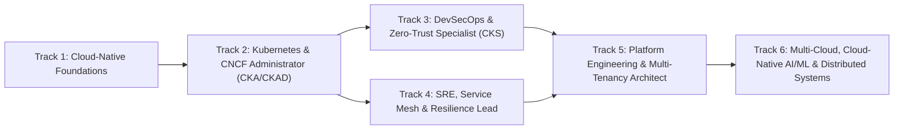

# Master Curriculum Catalog & Learning Path Matrix

**Document ID**: CURR-KUBELABS-2026-001  
**Version**: 2.0.0  
**Coverage**: 26 Domains | 6 Guided Role Tracks | 52 Hands-On Labs | 12 Live Production Incident Simulations | 8 Production Capstone Projects | 8 Enterprise Reference Architectures | 6 Verifiable Certifications

---

## 1. Guided Role Learning Paths

| Track ID | Role Title | Included Domains | Capstone Certification |
|---|---|---|---|
| `track-foundations` | Cloud-Native Systems Engineer | `linux-fundamentals`, `containers-runtime`, `cloud-networking`, `storage-csi-velero-dr` | Certified Cloud-Native Foundations Associate (CCNFA) |
| `track-k8s-admin` | Kubernetes & GitOps Administrator | `kubernetes-core`, `cncf-packaging`, `gitops-delivery`, `devops-cicd`, `k8s-control-plane-lifecycle` | Certified Kubernetes & GitOps Administrator (CKGA) |
| `track-devsecops` | DevSecOps & Zero-Trust Engineer | `devsecops-security`, `service-mesh`, `policy-as-code-kyverno`, `zero-trust-spiffe-externalsecrets` | Certified Cloud-Native Security Specialist (CCNSS) |
| `track-sre` | Principal SRE & Chaos Engineer | `observability-stack`, `sre-incident-chaos`, `gateway-api-cilium`, `autoscaling-keda-karpenter` | Certified Site Reliability & Incident Commander (CSRIC) |
| `track-platform` | Platform Engineering & FinOps Architect | `platform-engineering`, `iac-opentofu-terraform`, `finops-green-cloud`, `multitenancy-vcluster-crossplane` | Certified Platform Engineering Architect (CPEA) |
| `track-multicloud-aiops` | Multi-Cloud & AI-Ops Principal | `cloud-aws`, `cloud-azure-gcp`, `aiops-autonomous`, `wasm-ebpf-edge`, `cloud-native-aiml-kserve` | Certified Multi-Cloud & AI-Ops Principal (CMCAP) |

---

## 2. Domain-by-Domain Curriculum Specification

### Domain 01: Linux Systems & Kernel Fundamentals (`linux-fundamentals`)
- **Prerequisites**: None (Entry Domain)
- **Objectives**: Master kernel namespaces (`pid`, `net`, `mnt`, `uts`, `ipc`, `user`), `cgroups v2` resource isolation, `systemd` unit lifecycle, filesystem permissions, and process diagnostics.
- **Hands-On Labs**:
  1. `lab-linux-01`: **Process Isolation, Cgroups v2 & Systemd Service Hardening** — Inspect kernel parameters, analyze running processes/memory, and provision a hardened production `kubelet` systemd unit state.
  2. `lab-linux-02`: **Kernel Networking & Socket Diagnostics** — Audit listening TCP sockets (`ss`), inspect routing tables (`ip route`), and deploy a sysctl kernel tuning ConfigMap for high-throughput nodes.
- **Troubleshooting Exercise**: Diagnose a node suffering from ephemeral port exhaustion and file-descriptor starvation.
- **Production Scenario**: Hardening bare-metal Linux worker nodes for a high-frequency financial trading Kubernetes cluster.

### Domain 02: Containers & OCI Runtimes (`containers-runtime`)
- **Prerequisites**: `linux-fundamentals`
- **Objectives**: Understand OCI image specifications, overlayfs layers, multi-stage builds, rootless execution, distroless base images, and `containerd`/`crictl` runtime debugging.
- **Hands-On Labs**:
  1. `lab-containers-01`: **OCI Container Execution & Rootless Hardening** — Run, inspect, and deploy a non-root containerized microservice with read-only root filesystem and dropped Linux capabilities.
  2. `lab-containers-02`: **Runtime Debugging & Image Tag Remediation** — Diagnose a broken container image deployment (`ImagePullBackOff`) and roll out a verified signed OCI tag.
- **Troubleshooting Exercise**: Resolve container startup failures caused by UID permission denied on mounted volumes.
- **Production Scenario**: Migrating legacy monolithic containers to distroless, multi-stage OCI images with `< 25MB` attack surface.

### Domain 03: Cloud-Native Networking, CNI & eBPF (`cloud-networking`)
- **Prerequisites**: `linux-fundamentals`, `containers-runtime`
- **Objectives**: Master Pod-to-Pod networking, CNI plugins (Cilium eBPF, Calico BGP), CoreDNS resolution, `ClusterIP`/`NodePort`/`LoadBalancer`, Ingress controllers, and Kubernetes Gateway API.
- **Hands-On Labs**:
  1. `lab-net-01`: **Service Discovery & Zero-Endpoint Selector Remediation** — Diagnose a broken Kubernetes Service with `0 endpoints` caused by label selector drift and restore L4 connectivity.
  2. `lab-net-02`: **Ingress Routing & TLS Termination** — Configure an Ingress resource routing external HTTPS traffic to internal microservices with path-based routing.
- **Troubleshooting Exercise**: Fix intermittent DNS lookup timeouts and broken service-to-service routing across namespaces.
- **Production Scenario**: Designing a Cilium eBPF kube-proxy-less dataplane handling 500k requests/second.

### Domain 04: Kubernetes Core Architecture & Workloads (`kubernetes-core`)
- **Prerequisites**: `containers-runtime`, `cloud-networking`
- **Objectives**: Master `etcd`, `kube-apiserver`, `kube-scheduler`, `kube-controller-manager`, Pods, Deployments, StatefulSets, DaemonSets, ConfigMaps, Secrets, PV/PVCs, Liveness/Readiness Probes, HPA, and RBAC.
- **Hands-On Labs**:
  1. `lab-k8s-01`: **High-Availability Deployment, Scaling & Self-Healing** — Deploy a multi-replica production web tier with CPU/Memory resource limits and readiness probes.
  2. `lab-k8s-02`: **RBAC Least-Privilege Access Control** — Create a scoped `ServiceAccount`, `Role`, and `RoleBinding` granting read-only pod inspection in a dedicated namespace.
- **Troubleshooting Exercise**: Rescue a `Pending` Deployment blocked by excessive CPU requests and node taints.
- **Production Scenario**: Running a zero-downtime rolling upgrade across a 3-AZ production cluster.

### Domain 05: CNCF Packaging: Helm, Kustomize & Operators (`cncf-packaging`)
- **Prerequisites**: `kubernetes-core`
- **Objectives**: Package applications with Helm v3 charts, manage environment overlays with Kustomize, extend the Kubernetes API with CustomResourceDefinitions (CRDs), and operate stateful workloads with Operators.
- **Hands-On Labs**:
  1. `lab-cncf-01`: **Helm Release Lifecycle & Production Values Override** — Install and upgrade a production chart release using `helm install`/`upgrade` and verify reconciled workloads.
  2. `lab-cncf-02`: **Custom Resources & Operator Reconciliation** — Apply a Custom Resource and verify controller reconciliation of backing pods and services.
- **Troubleshooting Exercise**: Roll back a failed Helm upgrade that introduced an invalid configuration template.
- **Production Scenario**: Standardizing 120 microservices across Dev, Staging, and Prod with Helm and Kustomize.

### Domain 06: GitOps & Progressive Delivery (`gitops-delivery`)
- **Prerequisites**: `kubernetes-core`, `cncf-packaging`
- **Objectives**: Implement pull-based GitOps reconciliation with Argo CD and Flux, detect and heal configuration drift, and orchestrate Canary/Blue-Green deployments with Argo Rollouts.
- **Hands-On Labs**:
  1. `lab-gitops-01`: **Argo CD Application Sync & Drift Remediation** — Synchronize an `OutOfSync` Argo CD Application and verify automated self-healing in the target namespace.
  2. `lab-gitops-02`: **Progressive Canary Rollout Configuration** — Deploy a canary workload with automated traffic promotion and rollback gates.
- **Troubleshooting Exercise**: Resolve an Argo CD `SyncFailed` state caused by an invalid target revision and namespace mismatch.
- **Production Scenario**: Multi-cluster GitOps fleet management using the Argo CD App-of-Apps and ApplicationSet patterns.

### Domain 07: DevOps & Cloud-Native CI/CD Pipelines (`devops-cicd`)
- **Prerequisites**: `containers-runtime`, `kubernetes-core`
- **Objectives**: Design cloud-native pipelines using GitHub Actions and Tekton, track DORA metrics (Deployment Frequency, Lead Time, Change Failure Rate, MTTR), and implement immutable artifact promotion.
- **Hands-On Labs**:
  1. `lab-cicd-01`: **Cloud-Native CI/CD Runner & Artifact Promotion** — Deploy a Kubernetes-native pipeline runner workload and promote a verified build artifact to production.
  2. `lab-cicd-02`: **Zero-Downtime Rolling Update & Rollout Verification** — Execute a controlled image update on a live deployment and verify rollout status.
- **Troubleshooting Exercise**: Identify and roll back a defective release that spiked HTTP 5xx rates during deployment.
- **Production Scenario**: Achieving Elite DORA performance with automated quality gates and ephemeral preview environments.

### Domain 08: DevSecOps, Supply Chain & Runtime Security (`devsecops-security`)
- **Prerequisites**: `kubernetes-core`, `cloud-networking`
- **Objectives**: Enforce Pod Security Standards (`restricted`), default-deny `NetworkPolicy`, container vulnerability scanning (`trivy`), runtime syscall detection (`falco`), image signing (`cosign`/SLSA), and policy-as-code (`Kyverno`/`OPA`).
- **Hands-On Labs**:
  1. `lab-sec-01`: **Zero-Trust NetworkPolicy Micro-Segmentation** — Apply a strict `NetworkPolicy` isolating a sensitive `payments-db` pod so only `payments-api` can connect on port `5432`.
  2. `lab-sec-02`: **Pod Security Hardening & Vulnerability Remediation** — Scan images with `trivy` and remediate a privileged pod to run as non-root (`runAsNonRoot: true`) with a patched image tag.
- **Troubleshooting Exercise**: Unblock legitimate microservice communication accidentally severed by an overly broad egress policy while preserving zero-trust isolation.
- **Production Scenario**: PCI-DSS & SOC2 compliance hardening for a regulated fintech Kubernetes platform.

### Domain 09: Service Mesh (`service-mesh`)
- **Prerequisites**: `cloud-networking`, `devsecops-security`
- **Objectives**: Master sidecar and ambient service mesh architectures (Istio, Cilium Service Mesh), strict mutual TLS (`PeerAuthentication`), canary traffic splitting (`VirtualService`/`DestinationRule`), circuit breaking, and fault injection.
- **Hands-On Labs**:
  1. `lab-mesh-01`: **Istio Canary Traffic Splitting (90/10 Routing)** — Configure an Istio `VirtualService` and `DestinationRule` routing 90% of traffic to `v1` and 10% to `v2`.
  2. `lab-mesh-02`: **Strict mTLS Enforcement Across Mesh Workloads** — Apply a strict mTLS `PeerAuthentication` policy and verify proxy synchronization with `istioctl`.
- **Troubleshooting Exercise**: Fix `503 UC` upstream connection failures caused by an mTLS mode mismatch between client and server subsets.
- **Production Scenario**: Zero-trust encryption in transit and progressive traffic shadowing across 200 microservices.

### Domain 10: Observability Stack (`observability-stack`)
- **Prerequisites**: `kubernetes-core`
- **Objectives**: Instrument workloads with OpenTelemetry (metrics, logs, traces), write PromQL queries, configure Prometheus `ServiceMonitor` and `PrometheusRule` alerts, aggregate logs with Loki, and build RED/USE Grafana dashboards.
- **Hands-On Labs**:
  1. `lab-obs-01`: **Prometheus Alerting Rules & Metrics Scraping** — Deploy a `PrometheusRule` alerting on high HTTP 5xx error rates and verify metrics exporter endpoints.
  2. `lab-obs-02`: **OpenTelemetry Collector Deployment & Trace Pipeline** — Provision an OpenTelemetry collector deployment receiving OTLP traces and exporting telemetry.
- **Troubleshooting Exercise**: Fix a broken Prometheus scrape target caused by mismatched port annotations.
- **Production Scenario**: Unified observability pipeline handling 10M active time-series with high-cardinality protection.

### Domain 11: SRE, Incident Response & Chaos Engineering (`sre-incident-chaos`)
- **Prerequisites**: `observability-stack`, `kubernetes-core`
- **Objectives**: Define SLIs, SLOs, and Error Budget burn-rate alerts; execute controlled Chaos Engineering experiments (pod kill, network latency, CPU stress); lead structured incident response and blameless postmortems.
- **Hands-On Labs**:
  1. `lab-sre-01`: **CrashLoopBackOff Root-Cause Analysis & Recovery** — Diagnose and fix a critical `checkout-service` failing in `CrashLoopBackOff` due to a misconfigured secret/command.
  2. `lab-sre-02`: **HorizontalPodAutoscaler & Chaos Resilience** — Configure an `HorizontalPodAutoscaler` and verify workload survival under simulated pod failure.
- **Troubleshooting Exercise**: Restore availability during a cascading retry storm and memory `OOMKilled` outage.
- **Production Scenario**: Running quarterly GameDays to validate 99.99% availability SLOs.

### Domain 12: Platform Engineering & Internal Developer Platforms (`platform-engineering`)
- **Prerequisites**: `gitops-delivery`, `cncf-packaging`
- **Objectives**: Treat the platform as a product; build Golden Paths, Backstage software catalogs, and Crossplane `CompositeResourceDefinitions` (XRDs) for self-service cloud infrastructure.
- **Hands-On Labs**:
  1. `lab-plat-01`: **Crossplane Composite Cloud Claim Provisioning** — Apply a self-service `PostgresInstance` claim that provisions backing database infrastructure automatically.
  2. `lab-plat-02`: **Golden Path Microservice Template Deployment** — Provision a compliant microservice with built-in telemetry, security context, and GitOps labels.
- **Troubleshooting Exercise**: Diagnose a stalled Crossplane composition claim missing provider credentials.
- **Production Scenario**: Reducing new microservice onboarding time from 3 weeks to 10 minutes via an Internal Developer Platform.

### Domain 13: Infrastructure as Code: OpenTofu & Terraform (`iac-opentofu-terraform`)
- **Prerequisites**: `linux-fundamentals`, `cloud-networking`
- **Objectives**: Master declarative HCL, remote state locking, reusable modules, `tofu init/plan/apply`, drift detection, and policy-as-code validation.
- **Hands-On Labs**:
  1. `lab-iac-01`: **Provisioning Cloud-Native Infrastructure with OpenTofu** — Initialize, validate, plan, and apply an OpenTofu configuration provisioning a managed Kubernetes cluster and VPC.
  2. `lab-iac-02`: **Terraform State Drift Detection & Reconciliation** — Inspect state with `tofu state list` and reconcile drifted infrastructure back to declarative convergence.
- **Troubleshooting Exercise**: Recover from out-of-band manual console changes that broke infrastructure state alignment.
- **Production Scenario**: Multi-account, multi-region infrastructure pipelines using immutable OpenTofu modules.

### Domain 14: AWS Cloud-Native & EKS Architecture (`cloud-aws`)
- **Prerequisites**: `kubernetes-core`, `iac-opentofu-terraform`
- **Objectives**: Architect production Amazon EKS clusters, IAM Roles for Service Accounts (IRSA / Pod Identity), AWS VPC CNI, Karpenter node autoscaling, AWS Load Balancer Controller, and EBS/EFS CSI storage.
- **Hands-On Labs**:
  1. `lab-aws-01`: **Amazon EKS Cluster & IRSA Workload Identity** — Provision an EKS cluster resource and configure a `ServiceAccount` annotated with an IAM Role ARN for least-privilege S3 access.
  2. `lab-aws-02`: **Karpenter NodePool & Spot Consolidation** — Configure a high-efficiency AWS node pool for elastic workload scheduling.
- **Troubleshooting Exercise**: Fix `AccessDenied` S3 errors inside a Pod caused by missing OIDC trust annotations on the Kubernetes ServiceAccount.
- **Production Scenario**: Multi-AZ Amazon EKS platform with Karpenter Spot/On-Demand blending saving 62% on EC2 compute.

### Domain 15: Azure (AKS) & Google Cloud (GKE) Multi-Cloud (`cloud-azure-gcp`)
- **Prerequisites**: `kubernetes-core`, `cloud-aws`
- **Objectives**: Master Azure Kubernetes Service (AKS), Entra Workload Identity, Google Kubernetes Engine (GKE Autopilot/Standard), GKE Workload Identity Federation, and multi-cloud fleet management.
- **Hands-On Labs**:
  1. `lab-mc-01`: **Azure AKS & Google GKE Multi-Cloud Provisioning** — Provision AKS and GKE cluster control planes using `az aks` and `gcloud container` CLI workflows and deploy federated workloads.
  2. `lab-mc-02`: **Multi-Cloud Workload Identity Binding** — Configure workload identity annotations mapping Kubernetes ServiceAccounts to Azure/GCP IAM identities.
- **Troubleshooting Exercise**: Resolve cross-cloud ingress health-check failures in an active-active deployment.
- **Production Scenario**: Regulated multi-cloud disaster recovery across AWS EKS, Azure AKS, and Google GKE.

### Domain 16: AI-Ops, Autonomous Remediation & GPU Workloads (`aiops-autonomous`)
- **Prerequisites**: `observability-stack`, `sre-incident-chaos`
- **Objectives**: Schedule GPU workloads (`nvidia.com/gpu`), deploy LLM inference services (vLLM/Triton) on Kubernetes, run AI-driven root-cause analysis (`aiops analyze`), predictive autoscaling, and policy-guarded autonomous remediation.
- **Hands-On Labs**:
  1. `lab-aiops-01`: **GPU Workload Scheduling & LLM Inference Deployment** — Deploy an `llm-inference` service requesting GPU resources with node tolerations onto GPU-accelerated worker nodes.
  2. `lab-aiops-02`: **AI-Ops Automated Root Cause Analysis & Self-Healing** — Run `aiops analyze` and `aiops remediate` to detect and heal cluster anomalies automatically.
- **Troubleshooting Exercise**: Diagnose a `Pending` GPU inference pod blocked by missing `nvidia.com/gpu` tolerations.
- **Production Scenario**: Operating a multi-tenant Kubernetes AI inference platform with automated anomaly detection and sub-minute remediation.

### Domain 17: WebAssembly, eBPF Tetragon & Edge K3s (`wasm-ebpf-edge`)
- **Prerequisites**: `containers-runtime`, `cloud-networking`, `devsecops-security`
- **Objectives**: Schedule sub-millisecond WebAssembly serverless modules using Kubernetes `RuntimeClass` (`wasmtime-spin`), enforce synchronous in-kernel security via Cilium Tetragon eBPF `TracingPolicy`, and manage K3s/KubeEdge workloads.
- **Hands-On Labs**:
  1. `lab-wasm-01`: **Deploying Sub-Millisecond WebAssembly Workloads with RuntimeClass** — Deploy a serverless Wasm microservice using `runtimeClassName: wasmtime-spin`.
  2. `lab-wasm-02`: **Enforcing eBPF Kernel TracingPolicy with Cilium Tetragon** — Deploy a synchronous eBPF kernel enforcement policy blocking unauthorized container execution.
- **Troubleshooting Exercise**: Fix scheduling rejections on worker nodes lacking containerd Wasm shims.
- **Production Scenario**: Running ultra-low latency edge microservices cold-starting in `< 1ms` on retail edge clusters.

### Domain 18: Cloud-Native FinOps & Sustainable Green Computing (`finops-green-cloud`)
- **Prerequisites**: `kubernetes-core`, `observability-stack`
- **Objectives**: Implement CNCF OpenCost unit economics, mandatory cost-center showback/chargeback allocation, rightsizing CPU/memory slack, and pod-level power/carbon telemetry with CNCF Kepler.
- **Hands-On Labs**:
  1. `lab-finops-01`: **Deploying CNCF OpenCost & Enforcing FinOps Cost-Center Attribution** — Deploy OpenCost in monitoring and tag production workloads with verified cost-allocation labels.
  2. `lab-finops-02`: **Right-Sizing Over-Provisioned Workloads & Deploying Kepler Energy Exporter** — Eliminate replica slack and deploy Kepler to measure hardware power consumption per pod.
- **Troubleshooting Exercise**: Track down silent cloud cost spikes caused by unbound replica scaling.
- **Production Scenario**: Achieving 35% cloud infrastructure cost reduction and tracking carbon intensity across multi-tenant clusters.

### Domain 19: K8s Control Plane Internals, etcd & Upgrades (`k8s-control-plane-lifecycle`)
- **Prerequisites**: `linux-fundamentals`, `kubernetes-core`
- **Objectives**: Master static pod manifests, Raft quorum mechanics, etcd snapshot saves and point-in-time recovery, kubeadm multi-node minor version upgrades, node drain disruption budgets, and TLS PKI certificate rotation.
- **Hands-On Labs**:
  1. `lab-cp-01`: **etcd Snapshot Backup and Point-in-Time Disaster Recovery** — Execute `etcdctl snapshot save`, verify member endpoint health, and record backup audit state.
  2. `lab-cp-02`: **Kubeadm Cluster Upgrade & Safe Node Drain Sequence** — Plan upgrade with `kubeadm upgrade plan`, cordon and drain nodes safely with `--ignore-daemonsets`, and verify cluster status.
- **Troubleshooting Exercise**: Restore an etcd quorum split-brain state caused by network partitioning across control plane nodes.
- **Production Scenario**: Orchestrating zero-downtime rolling upgrades across 500-node production clusters running critical financial workloads.

### Domain 20: Next-Gen Networking: Kubernetes Gateway API & Cilium eBPF (`gateway-api-cilium`)
- **Prerequisites**: `cloud-networking`, `kubernetes-core`
- **Objectives**: Implement Kubernetes Gateway API (`GatewayClass`, `Gateway`, `HTTPRoute`), path prefix matching, header-based routing, Cilium eBPF kube-proxy replacement, and Hubble L7 flow observability.
- **Hands-On Labs**:
  1. `lab-gw-01`: **GatewayClass, Gateway, and HTTPRoute Path Routing** — Provision an enterprise Gateway listener on port 80 and route `/api/v1` and `/web` to decoupled backend services.
  2. `lab-gw-02`: **Cilium eBPF NetworkPolicy & Hubble L7 Flow Inspection** — Deploy `CiliumNetworkPolicy` with L7 HTTP method filtering and inspect network flows using Hubble CLI.
- **Troubleshooting Exercise**: Diagnose traffic blackholes caused by mismatched Gateway listeners and HTTPRoute parentRefs.
- **Production Scenario**: Transitioning legacy Ingress controller fleets to Kubernetes Gateway API with Cilium eBPF accelerated datapath.

### Domain 21: Policy-as-Code & Cluster Governance with Kyverno (`policy-as-code-kyverno`)
- **Prerequisites**: `kubernetes-core`, `devsecops-security`
- **Objectives**: Enforce declarative Kubernetes governance with Kyverno `ClusterPolicy`, validate Pod Security Standards (`restricted`), mutate incoming pod manifests to inject mandatory metadata/labels, and generate audit reports.
- **Hands-On Labs**:
  1. `lab-kyv-01`: **Enforcing Pod Security Admission via Kyverno ClusterPolicy** — Deploy an admission control policy disallowing privileged containers and hostPID sharing.
  2. `lab-kyv-02`: **Kyverno Mutating Policy for Mandatory Workload Tags** — Automatically inject `team: platform` and `cost-center: engineering` annotations into unlabelled production pods.
- **Troubleshooting Exercise**: Unblock failed deployment rollouts rejected by an overly strict Kyverno validating webhook configuration.
- **Production Scenario**: Enterprise guardrail enforcement across 25 development teams ensuring SOC2 compliance at admission time.

### Domain 22: Advanced Autoscaling: KEDA & Karpenter (`autoscaling-keda-karpenter`)
- **Prerequisites**: `kubernetes-core`, `observability-stack`, `cloud-aws`
- **Objectives**: Master event-driven autoscaling with KEDA (RabbitMQ/Kafka queue depths, Prometheus metric triggers), scale down to zero, and configure AWS Karpenter just-in-time node provisioning with disruption consolidation.
- **Hands-On Labs**:
  1. `lab-auto-01`: **Event-Driven Microservice Autoscaling with KEDA ScaledObject** — Autoscale consumer pods dynamically between 1 and 20 based on message queue lag triggers.
  2. `lab-auto-02`: **Karpenter NodePool & Disruption Budget Configuration** — Architect an enterprise Karpenter NodePool with Spot instances, arm64 architectures, and consolidation policies.
- **Troubleshooting Exercise**: Fix KEDA ScaledObject trigger authentication failures preventing consumer scaling.
- **Production Scenario**: Slashing idle compute costs by 70% using KEDA scale-to-zero and Karpenter sub-minute node provisioning.

### Domain 23: Production Storage, CSI & Velero Disaster Recovery (`storage-csi-velero-dr`)
- **Prerequisites**: `kubernetes-core`, `linux-fundamentals`
- **Objectives**: Implement Container Storage Interface (CSI), dynamic PersistentVolume provisioning with custom `StorageClass` configurations (Retain/Delete, VolumeBindingMode), and orchestrate full-cluster snapshot backups and restores with Velero.
- **Hands-On Labs**:
  1. `lab-stor-01`: **Dynamic Persistent Volume Provisioning with Custom StorageClass** — Deploy an encrypted SSD StorageClass with `WaitForFirstConsumer` binding and bind a PVC.
  2. `lab-stor-02`: **Velero Cluster Disaster Recovery Backup & Scheduled Schedule** — Create on-demand and recurring Velero backups protecting persistent volumes and stateful deployments.
- **Troubleshooting Exercise**: Recover stateful databases from persistent volume claim binding deadlocks caused by mismatched zone topologies.
- **Production Scenario**: Cross-region multi-cloud disaster recovery runbook restoring critical stateful infrastructure in `< 15 minutes`.

### Domain 24: Multi-Tenancy, Virtual Clusters (vcluster) & Crossplane (`multitenancy-vcluster-crossplane`)
- **Prerequisites**: `kubernetes-core`, `platform-engineering`
- **Objectives**: Architect hard multi-tenancy on shared physical infrastructure using Loft vcluster, separate tenant control planes, enforce ResourceQuota and LimitRange constraints, and provision external cloud resources via Crossplane composite claims.
- **Hands-On Labs**:
  1. `lab-ten-01`: **Virtual Cluster Isolation with vcluster & Namespace Quotas** — Deploy an isolated virtual control plane inside a host tenant namespace with strict CPU/memory limits.
  2. `lab-ten-02`: **Crossplane Composite Cloud Infrastructure Claim** — Declare composite infrastructure claims to bind RDS PostgreSQL instances and S3 buckets directly from tenant manifests.
- **Troubleshooting Exercise**: Resolve cross-tenant noisy neighbor CPU contention and API server saturation.
- **Production Scenario**: Enterprise Internal Developer Platform hosting 300 engineering teams on shared infrastructure with zero noisy-neighbor interference.

### Domain 25: Zero-Trust Identity, SPIFFE/SPIRE & External Secrets (`zero-trust-spiffe-externalsecrets`)
- **Prerequisites**: `devsecops-security`, `service-mesh`
- **Objectives**: Implement cryptographic zero-trust workload identity with SPIFFE/SPIRE (SVID X.509 issuance), eliminate long-lived cluster secrets using External Secrets Operator (ESO), and synchronize credentials from HashiCorp Vault or AWS Secrets Manager.
- **Hands-On Labs**:
  1. `lab-zt-01`: **External Secrets Operator Sync from AWS/Vault SecretStore** — Configure `ClusterSecretStore` and `ExternalSecret` reconciling encrypted secrets from external secret vaults into native Kubernetes Secrets.
  2. `lab-zt-02`: **SPIFFE/SPIRE Workload Identity SVID Attestation** — Register workloads with SPIRE server and verify mTLS SVID token attestation.
- **Troubleshooting Exercise**: Remediate expired external secret sync tokens causing application authentication failure.
- **Production Scenario**: Eliminating plaintext secret sprawl across git repositories and enforcing short-lived ephemeral credential rotation.

### Domain 26: Cloud-Native AI/ML Platforms: Kubeflow, Ray & KServe (`cloud-native-aiml-kserve`)
- **Prerequisites**: `aiops-autonomous`, `cloud-aws`, `cloud-azure-gcp`
- **Objectives**: Architect scalable cloud-native AI/ML infrastructure with Kubeflow Training Operator (distributed PyTorchJob/TFJob), Ray clusters for distributed compute, and serverless model inference deployment via KServe InferenceService with canary traffic splitting.
- **Hands-On Labs**:
  1. `lab-ai-01`: **High-Performance InferenceService Deployment with KServe** — Deploy a serverless transformer LLM model serving endpoint with vLLM runtime and GPU hardware acceleration.
  2. `lab-ai-02`: **Model Mesh Routing, Canary Canary Splitting & GPU Metrics** — Configure 90/10 traffic splitting between model revisions and track GPU inference latency metrics.
- **Troubleshooting Exercise**: Diagnose out-of-memory CUDA crashes (`OOMKilled`) during distributed multi-node LLM training.
- **Production Scenario**: Planetary-scale Generative AI platform serving 50M inference requests daily across hybrid GPU cloud clusters.

---

## 3. Real-World Multi-Milestone Capstone Projects

| Project ID | Career Track | Project Title | Milestones | XP Reward |
|---|---|---|---|---|
| `proj-01-hardened-edge-node` | `track-foundations` | Hardened Linux Node, Distroless Runtime & L7 Ingress Gateway | 1. Kernel Sysctl ConfigMap 2. Distroless Non-Root Deployment 3. ClusterIP Service & Ingress Routing | 400 XP |
| `proj-02-gitops-ha-commerce` | `track-k8s-admin` | Multi-AZ GitOps Commerce Platform with Helm, Argo CD & RBAC | 1. Scoped ServiceAccount & Role 2. Helm Redis Cache Release 3. Argo CD Application Sync | 450 XP |
| `proj-03-zero-trust-fintech` | `track-devsecops` | Zero-Trust PCI-DSS Payment Vault (NetworkPolicy + Istio mTLS + Non-Root) | 1. Trivy Scan & Non-Root Pod 2. Ingress NetworkPolicy Isolation 3. Istio STRICT PeerAuthentication | 500 XP |
| `proj-04-sre-autonomous-observability` | `track-sre` | High-Resilience SRE Platform (OpenTelemetry, SLO Alerting & HPA) | 1. CrashLoopBackOff Recovery 2. HorizontalPodAutoscaler Scaling 3. PrometheusRule SLO Burn Alert | 450 XP |
| `proj-05-idp-crossplane-finops` | `track-platform` | Internal Developer Platform (OpenTofu + Crossplane + OpenCost FinOps) | 1. OpenTofu Cloud Foundation 2. Crossplane Database Claim 3. OpenCost FinOps Deployment | 500 XP |
| `proj-06-multicloud-aiops-gpu` | `track-multicloud-aiops` | Multi-Cloud Federated AI Inference Platform & Autonomous AI-Ops | 1. EKS & GKE Fleet Verification 2. GPU Taint-Tolerant LLM Scheduling 3. AI-Ops Anomaly Remediation | 550 XP |
| `proj-07-multitenant-vcluster-platform` | `track-platform` | Multi-Tenant Virtual Cluster Platform with Kyverno & vCluster | 1. Isolated Tenant Namespace & ResourceQuota 2. Kyverno ClusterPolicy Governance 3. Lightweight vCluster Control Plane 4. Cross-Tenant Network Isolation | 500 XP |
| `proj-08-kserve-distributed-ai-cloud` | `track-multicloud-aiops` | Cloud-Native Distributed AI Cloud with KServe & Ray Autoscaler | 1. Kubeflow PyTorchJob Distributed Training 2. KServe Serverless LLM Predictor 3. Inference Gateway Routing 4. AI-Ops Autonomous Saturation Analysis | 500 XP |

---

## 4. Live Production Incident Simulations (SRE & On-Call)

| Incident ID | Severity | Domain / Category | MTTR Budget | Root Cause & Resolution |
|---|---|---|---|---|
| `inc-01-selector-blackhole` | SEV-1 (P0) | `cloud-networking` | 10 min | Service label selector mismatch (`app: checkout-legacy` instead of `app: checkout-api`) causing 0 endpoints. Patch selector to restore endpoints. |
| `inc-02-bad-image-rollout` | SEV-1 (P0) | `kubernetes-core` | 8 min | Defective image tag (`auth:v2.9-broken`) triggering `ImagePullBackOff`. Roll back deployment or update image to stable tag. |
| `inc-03-crashloop-missing-secret` | SEV-2 (P1) | `devsecops-security` | 12 min | Container failing with `CrashLoopBackOff` due to missing database password Secret key. Create missing secret key to allow successful boot. |
| `inc-04-netpol-database-isolation` | SEV-1 (P0) | `devsecops-security` | 10 min | Default-deny `NetworkPolicy` inadvertently blocking API tier egress to backend PostgreSQL database. Create ingress rule for API selector. |
| `inc-05-cpu-starvation-pending` | SEV-2 (P1) | `kubernetes-core` | 15 min | Deployment pods stuck in `Pending` due to an unrealistic CPU request exceeding node capacity. Right-size CPU request down to fit cluster nodes. |
| `inc-06-istio-mtls-503-uc` | SEV-2 (P1) | `service-mesh` | 10 min | Istio `PeerAuthentication` enforces `STRICT` mTLS but client lacks sidecar proxy or matching `DestinationRule` TLS mode. Configure DestinationRule with `ISTIO_MUTUAL`. |
| `inc-07-argocd-drift-out-of-sync` | SEV-1 (P0) | `gitops-delivery` | 8 min | Ingress configuration out-of-sync with git repository triggering Argo CD drift alert. Execute sync operation to restore desired declarative state. |
| `inc-08-gpu-taint-scheduling-block` | SEV-1 (P0) | `aiops-autonomous` | 12 min | High-priority LLM inference pod pending because worker node is tainted `nvidia.com/gpu:NoSchedule`. Add matching toleration to pod spec. |
| `inc-09-etcd-quorum-loss` | SEV-1 (P0) | `k8s-control-plane-lifecycle` | 15 min | etcd cluster lost member quorum leading to API server read-only freeze. Restore etcd snapshot with `etcdctl snapshot restore` and verify health. |
| `inc-10-kyverno-admission-block` | SEV-1 (P0) | `policy-as-code-kyverno` | 10 min | Broken `ValidatingWebhookConfiguration` targeting unreachable endpoint rejecting all namespace creation. Patch failurePolicy to Ignore or delete invalid config. |
| `inc-11-coredns-loop-crash` | SEV-1 (P0) | `cloud-networking` | 12 min | Upstream DNS loop detected in CoreDNS Corefile causing CoreDNS pods to crash and cluster-wide name resolution failure. Fix forward configuration in CoreDNS ConfigMap. |
| `inc-12-pvc-storageclass-pending` | SEV-2 (P1) | `storage-csi-velero-dr` | 10 min | Stateful database PVC stuck in `Pending` because requested `StorageClass` does not exist. Create the required StorageClass to trigger dynamic volume binding. |

