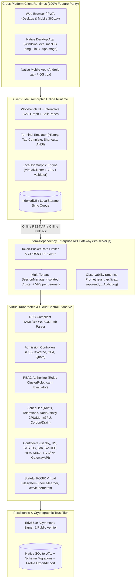

# KubeLabs v2.0 Enterprise Edition: World-Class Gap Analysis, Target-State Architecture, Global Engineering Contract & Master Execution Plan

> **Document ID**: `KL-ENT-GAP-v2.0`  
> **Classification**: Principal Architecture, Product, Curriculum, Security, SRE & QA Master Blueprint  
> **Target Platforms**: Web (PWA), Windows (x64/ARM64), Linux (x64/ARM64), macOS (Apple Silicon/Intel), Android, iOS  
> **Benchmark Baseline**: Exceeding KodeKloud, Killercoda, Instruqt, Pluralsight Labs, and Linux Foundation Simulators  

---

## Table of Contents

1. [Executive Assessment & Current-State Audit](#1-executive-assessment--current-state-audit)
2. [Comprehensive Multi-Dimensional Gap Analysis](#2-comprehensive-multi-dimensional-gap-analysis)
   - [2.1 Architectural & Multi-Tenancy Flaws](#21-architectural--multi-tenancy-flaws)
   - [2.2 True Offline Parity & Isomorphic Engine Gaps](#22-true-offline-parity--isomorphic-engine-gaps)
   - [2.3 Virtual Kubernetes Control Plane & Parser Gaps](#23-virtual-kubernetes-control-plane--parser-gaps)
   - [2.4 Built-In Terminal & Virtual Filesystem (VFS) Gaps](#24-built-in-terminal--virtual-filesystem-vfs-gaps)
   - [2.5 Security, Cryptography & Compliance Vulnerabilities](#25-security-cryptography--compliance-vulnerabilities)
   - [2.6 UI/UX, Accessibility & Visual Polish Gaps](#26-uiux-accessibility--visual-polish-gaps)
   - [2.7 Cross-Platform Native Packaging Gaps (Desktop & Mobile)](#27-cross-platform-native-packaging-gaps-desktop--mobile)
   - [2.8 Curriculum, Lab Depth & Commercial Benchmarking Gaps](#28-curriculum-lab-depth--commercial-benchmarking-gaps)
   - [2.9 Day-2 Operations, Observability & Scalability Bottlenecks](#29-day-2-operations-observability--scalability-bottlenecks)
3. [Prioritized Remediation & Innovation Matrix](#3-prioritized-remediation--innovation-matrix)
4. [Target-State Enterprise Architecture (KubeLabs v2.0)](#4-target-state-enterprise-architecture-kubelabs-v20)
   - [4.1 Isomorphic Dual-Runtime Engine (Server + Browser WebWorker)](#41-isomorphic-dual-runtime-engine-server--browser-webworker)
   - [4.2 Multi-Tenant Session Isolation & Snapshot Persistence](#42-multi-tenant-session-isolation--snapshot-persistence)
   - [4.3 Full-Fidelity Virtual Kubernetes Control Plane v2](#43-full-fidelity-virtual-kubernetes-control-plane-v2)
   - [4.4 Stateful Virtual Filesystem (VFS) & POSIX Shell Pipeline](#44-stateful-virtual-filesystem-vfs--posix-shell-pipeline)
   - [4.5 Cross-Platform Distribution Architecture (Web, Desktop, Mobile)](#45-cross-platform-distribution-architecture-web-desktop-mobile)
5. [Complete Curriculum Expansion Blueprint (18 → 26 Domains, 100+ Labs)](#5-complete-curriculum-expansion-blueprint-18--26-domains-100-labs)
6. [Global Engineering Contract (GEC-v2.0)](#6-global-engineering-contract-gec-v20)
7. [Agent Skills, Rules, Guardrails & Operating Procedures](#7-agent-skills-rules-guardrails--operating-procedures)
8. [Enterprise Engineering Standards (Architecture to Compliance)](#8-enterprise-engineering-standards-architecture-to-compliance)
9. [Definition of Ready (DoR), Definition of Done (DoD) & Quality Gates](#9-definition-of-ready-dor-definition-of-done-dod--quality-gates)
10. [Antigravity IDE Autonomous Execution Strategy](#10-antigravity-ide-autonomous-execution-strategy)
11. [Hierarchical Execution Plan (Stage → Phase → Subphase → Tasks)](#11-hierarchical-execution-plan-stage--phase--subphase--tasks)

---

## 1. Executive Assessment & Current-State Audit

### 1.1 What KubeLabs v1.0 Accomplished Well
KubeLabs v1.0 established a zero-dependency foundation (`45.6 MB` RSS memory, `< 120 ms` cold start, `329 ms` E2E test execution) with:
- **18 curriculum plugins** (`plugins/01-*.json` through `18-*.json`), **36 interactive labs**, **8 incident simulations**, **6 capstone projects**, **8 reference architectures**, and **6 role certification exams**.
- **Deterministic state validation** (`ValidationEngine`) that verifies every lab fails initially and passes 100% upon executing canonical solutions.
- **11-Agent self-audit framework** (`src/agents/orchestrator.js`) running 50 automated checks.

### 1.2 Why v1.0 Is Not Yet Enterprise / Commercial Leader Grade
A rigorous line-by-line code, architecture, UX, and curriculum audit against commercial leaders (**KodeKloud Pro**, **Killercoda**, **Instruqt**, **Linux Foundation CKA/CKS Simulator**) reveals **42 concrete engineering, architectural, security, UX, cross-platform, and curriculum gaps** that must be resolved to achieve true enterprise production readiness and cross-platform parity.

---

## 2. Comprehensive Multi-Dimensional Gap Analysis

### 2.1 Architectural & Multi-Tenancy Flaws

| Gap ID | Severity | Component | Concrete Code / Architecture Finding | Impact |
| :--- | :--- | :--- | :--- | :--- |
| **GAP-ARCH-01** | **CRITICAL** | [`src/api/router.js`](file:///h:/kubelabs/src/api/router.js#L68-L92) | `this.cluster` (`VirtualCluster`), `this.terminal` (`TerminalEngine`), `this.activeLabId`, and `this.activeIncidentId` are stored as singleton properties on `ApiRouter`. | **Zero multi-user/multi-tab concurrency**: If User B (or a second browser tab) starts a lab or runs a command, it mutates and wipes User A's active cluster state. |
| **GAP-ARCH-02** | **CRITICAL** | [`deploy/kubernetes/kubelabs-k8s.yaml`](file:///h:/kubelabs/deploy/kubernetes/kubelabs-k8s.yaml#L18-L35) | Deployment sets `replicas: 2` while mounting a single `ReadWriteOnce` (`RWO`) PVC (`kubelabs-sqlite-pvc`) onto `/app/data` for SQLite WAL. | **Broken HA Deployment**: Kubernetes `ReadWriteOnce` PVCs cannot mount on two nodes simultaneously; multi-pod SQLite over shared storage causes `SQLITE_BUSY` lock corruption, and in-memory cluster state is unsynchronized across pods. |
| **GAP-ARCH-03** | **HIGH** | [`src/db/database.js`](file:///h:/kubelabs/src/db/database.js#L150-L210) | `user_profile` hardcodes a single learner row (`id = 1`). All progress tables (`lab_progress`, `incident_runs`, `certificates`) lack a `tenant_id` / `user_id` foreign key index. | Cannot support multiple learner profiles on a shared workstation, classroom server, or enterprise team deployment. |

---

### 2.2 True Offline Parity & Isomorphic Engine Gaps

| Gap ID | Severity | Component | Concrete Code / Architecture Finding | Impact |
| :--- | :--- | :--- | :--- | :--- |
| **GAP-OFF-01** | **CRITICAL** | [`public/sw.js`](file:///h:/kubelabs/public/sw.js#L31-L42) | Line 32 states: `if (event.request.method !== 'GET') return;`. Meanwhile, every interactive action (`POST /api/terminal/exec`, `POST /api/labs/:id/start`, `POST /api/labs/:id/validate`, `POST /api/cluster/apply`, `POST /api/mentor/ask`) is an HTTP `POST` to the backend. | **False Offline Capability**: When the browser/mobile PWA is disconnected from the Node.js server, only cached `GET` assets load. Running any terminal command, applying YAML, or validating a lab immediately throws a network `fetch` error. |
| **GAP-OFF-02** | **HIGH** | [`public/js/app.js`](file:///h:/kubelabs/public/js/app.js#L16-L27) | `apiCall()` has no offline fallback, no client-side state synchronization queue, and no `IndexedDB` / `localStorage` state persistence. | Mobile (Android/iOS) and offline web users cannot execute labs locally inside the browser runtime or sync XP/certificates when connectivity returns. |

---

### 2.3 Virtual Kubernetes Control Plane & Parser Gaps

| Gap ID | Severity | Component | Concrete Code / Architecture Finding | Impact |
| :--- | :--- | :--- | :--- | :--- |
| **GAP-K8S-01** | **HIGH** | [`src/engine/virtualCluster.js`](file:///h:/kubelabs/src/engine/virtualCluster.js#L138) | Line 138 strips comments via `rawLine.replace(/\s+#.*$/, '')` globally before parsing scalars, corrupting strings containing `#`. Parser also lacks support for folded block scalars (`>`), YAML anchors (`&`/`*`), and complex multi-level list nesting. | Real-world Kubernetes manifests (e.g., ConfigMaps containing bash/nginx configs with `#` comments or Helm outputs) fail or parse inaccurately. |
| **GAP-K8S-02** | **HIGH** | [`src/engine/virtualCluster.js`](file:///h:/kubelabs/src/engine/virtualCluster.js#L350-L520) | Missing **RBAC Admission Controller**: Creating `Role`, `ClusterRole`, `RoleBinding`, `ClusterRoleBinding` stores the objects, but `kubectl auth can-i <verb> <resource> --as=<user>` does not actually evaluate subject rules against verb/resource permissions. | Security and RBAC troubleshooting labs rely on static object checks rather than real permission evaluation. |
| **GAP-K8S-03** | **HIGH** | [`src/engine/virtualCluster.js`](file:///h:/kubelabs/src/engine/virtualCluster.js#L410-L490) | Missing **Scheduler & Taint/Toleration/Affinity Engine**: Pods are not scheduled onto specific Nodes based on `nodeSelector`, `nodeAffinity`, `taints`/`tolerations`, `PodDisruptionBudget`, or node allocatable CPU/Memory/GPU capacity. | Cannot simulate real scheduling failures (`0/3 nodes are available: 1 node(s) had untolerated taint`, insufficient CPU/Memory, node cordoning/draining via `kubectl cordon`/`kubectl drain`). |
| **GAP-K8S-04** | **MEDIUM** | [`src/engine/virtualCluster.js`](file:///h:/kubelabs/src/engine/virtualCluster.js) | Missing **StatefulSet Ordinal Controller**, **DaemonSet Controller**, **Job/CronJob Controller**, **PV/PVC Storage Binder**, and **HPA Dynamic Scaling Loop**. | `StatefulSet` does not spawn deterministic `pod-0`, `pod-1` with per-replica `volumeClaimTemplates`; `PVC` objects don't dynamically bind to `PV` via `StorageClass`. |
| **GAP-K8S-05** | **MEDIUM** | [`src/engine/virtualCluster.js`](file:///h:/kubelabs/src/engine/virtualCluster.js) | Missing **Admission Webhook & Policy Engine (Kyverno / OPA Gatekeeper / PodSecurityStandards)** enforcement during `applyManifest`. | Applying a privileged pod into a namespace labeled `pod-security.kubernetes.io/enforce: restricted` succeeds instead of being rejected by the admission controller. |

---

### 2.4 Built-In Terminal & Virtual Filesystem (VFS) Gaps

| Gap ID | Severity | Component | Concrete Code / Architecture Finding | Impact |
| :--- | :--- | :--- | :--- | :--- |
| **GAP-TERM-01** | **HIGH** | [`src/engine/terminalEngine.js`](file:///h:/kubelabs/src/engine/terminalEngine.js) | **No Stateful Virtual Filesystem (VFS)**: Commands like `ls`, `cat`, `grep`, `kubectl apply -f` do not operate on an in-memory POSIX filesystem tree (`/home/learner`, `/etc/kubernetes/manifests`, `/var/log/pods`). | Learners cannot create multiple files (`deployment.yaml`, `service.yaml`, `values.yaml`), inspect `/etc/kubernetes/manifests/kube-apiserver.yaml`, or use `echo ... > file.yaml`. |
| **GAP-TERM-02** | **HIGH** | [`public/js/app.js`](file:///h:/kubelabs/public/js/app.js#L704-L711) | Terminal `<input>` lacks command history navigation (`ArrowUp`/`ArrowDown`), `Tab` auto-completion for CLI verbs/resources/pod names, `Ctrl+L` screen clear, `Ctrl+C` cancel, and ANSI color/table formatting. | Poor developer ergonomics compared to real terminal emulators (xterm.js / native shells). |
| **GAP-TERM-03** | **MEDIUM** | [`src/engine/terminalEngine.js`](file:///h:/kubelabs/src/engine/terminalEngine.js#L80-L150) | Missing support for `kubectl patch`, `kubectl label`, `kubectl annotate`, `kubectl cordon`, `kubectl uncordon`, `kubectl drain`, `kubectl taint`, `kubectl port-forward`, `kubectl config use-context`, `-o jsonpath=...`, and `etcdctl snapshot save/restore`. | Essential CKA/CKAD/CKS exam commands are unavailable or partially simulated. |

---

### 2.5 Security, Cryptography & Compliance Vulnerabilities

| Gap ID | Severity | Component | Concrete Code / Architecture Finding | Impact |
| :--- | :--- | :--- | :--- | :--- |
| **GAP-SEC-01** | **HIGH** | [`public/js/app.js`](file:///h:/kubelabs/public/js/app.js#L76-L100) | Multiple `innerHTML` templates interpolate resource names, namespaces, architecture node labels, and learner names without HTML entity sanitization (`escapeHtml`). | **Stored/Reflected DOM XSS**: Applying a YAML manifest with `metadata.name: ""` executes arbitrary JavaScript in the user's browser. |
| **GAP-SEC-02** | **MEDIUM** | [`src/engine/certificationEngine.js`](file:///h:/kubelabs/src/engine/certificationEngine.js) | Uses symmetric HMAC-SHA256 with a static fallback string secret when `process.env.KUBELABS_CERT_SECRET` is unset. | Anyone inspecting the open-source code knows the fallback HMAC key and can forge certificate signatures. Should use asymmetric **Ed25519** (`node:crypto.sign`/`verify`) with an exported public verification key. |
| **GAP-SEC-03** | **MEDIUM** | [`src/api/router.js`](file:///h:/kubelabs/src/api/router.js) | No per-IP / per-session rate limiter on API endpoints, no CSRF/Origin validation on `POST` endpoints, and no structured security audit log. | Vulnerable to local brute-force exam submission or memory exhaustion via rapid session creation. |

---

### 2.6 UI/UX, Accessibility & Visual Polish Gaps

| Gap ID | Severity | Component | Concrete Code / Architecture Finding | Impact |
| :--- | :--- | :--- | :--- | :--- |
| **GAP-UX-01** | **HIGH** | [`public/index.html`](file:///h:/kubelabs/public/index.html#L23-L46) & [`public/js/app.js`](file:///h:/kubelabs/public/js/app.js) | UI text inconsistencies (`16-Domain Skill Mastery Matrix` on line 274 vs 18 actual plugins), no interactive SVG topology graph (currently renders a flat list of `.resource-chip` divs), and no interactive Capstone Project workbench view (currently only has a 1-click "Build & Validate" auto-solve button). | Learners cannot complete Capstone Projects milestone-by-milestone interactively, nor visually see arrows connecting Ingress → Service → Pod → PVC in the cluster visualizer. |
| **GAP-UX-02** | **MEDIUM** | [`public/css/styles.css`](file:///h:/kubelabs/public/css/styles.css) | No resizable split panes in the 3-column workbench, no Light/High-Contrast theme toggle for accessibility (WCAG 2.1 AA), no YAML line numbers or syntax error gutter in the Manifest Editor, and no mobile bottom-sheet navigation for `< 768px` viewports. | Constrained screen real estate on 13" laptops and mobile devices. |

---

### 2.7 Cross-Platform Native Packaging Gaps (Desktop & Mobile)

| Gap ID | Severity | Component | Concrete Code / Architecture Finding | Impact |
| :--- | :--- | :--- | :--- | :--- |
| **GAP-PLAT-01** | **HIGH** | `deploy/` | Only `Dockerfile`, `docker-compose.yml`, and `deploy/kubernetes/kubelabs-k8s.yaml` exist. Missing native Desktop wrappers (Windows `.exe`/`.msi`, macOS `.dmg`/`.app`, Linux `.AppImage`/`.deb`) and Mobile wrappers (Android `.apk`/`.aab`, iOS `.ipa`), plus automated CLI launcher (`npx kubelabs`). | Does not fulfill the standalone native cross-platform installer requirement across Windows, macOS, Linux, Android, and iOS. |

---

### 2.8 Curriculum, Lab Depth & Commercial Benchmarking Gaps

Benchmarking KubeLabs v1.0 against **KodeKloud**, **Killercoda**, **Instruqt**, and official **CNCF Certification Syllabi (CKA, CKAD, CKS, KCNA, KCSA, CAPA, CGOA, PCA)** identifies 8 critical missing domains and depth gaps:

1. **Missing Domain 19 — Kubernetes Control Plane Internals, `kubeadm` & Cluster Lifecycle**:
   - Missing `etcd` backup & restore (`etcdctl snapshot save/restore`), control plane static pod failure debugging (`/etc/kubernetes/manifests`), `kubeadm` version upgrades (`1.30` → `1.31`), kubelet systemd debugging (`journalctl -u kubelet`), and certificate renewal (`kubeadm certs check-expiration`).
2. **Missing Domain 20 — Gateway API, Cilium CNI & L7 Service Mesh**:
   - Missing Kubernetes Gateway API (`GatewayClass`, `Gateway`, `HTTPRoute`, `GRPCRoute`), traffic splitting/mirroring, and Cilium L7 HTTP-aware `CiliumNetworkPolicy`.
3. **Missing Domain 21 — Policy-as-Code & Dynamic Admission Control (Kyverno, OPA Gatekeeper & CEL)**:
   - Missing `ValidatingAdmissionPolicy` (Kubernetes native CEL), Kyverno `ClusterPolicy` (mutate/validate/generate), and OPA Gatekeeper `ConstraintTemplate`.
4. **Missing Domain 22 — Advanced Autoscaling & Batch Scheduling (KEDA, Karpenter, Kueue)**:
   - Missing event-driven scaling with KEDA (`ScaledObject`), node consolidation with Karpenter (`NodePool`, `EC2NodeClass`), PodDisruptionBudgets (`PDB`), PriorityClasses, and TopologySpreadConstraints.
5. **Missing Domain 23 — Cloud-Native Storage, CSI Snapshots & Disaster Recovery (Velero & Rook-Ceph)**:
   - Missing CSI `StorageClass` expansion, `VolumeSnapshot`, Velero cluster backup/restore schedules, and cross-region disaster recovery drills.
6. **Missing Domain 24 — Multi-Tenancy, Virtual Clusters (`vCluster`) & Crossplane Control Planes**:
   - Missing `ResourceQuota`, `LimitRange`, `vCluster` tenant isolation, and Crossplane (`CompositeResourceDefinition`, `Composition`) for Kubernetes-native multi-cloud provisioning.
7. **Missing Domain 25 — Zero-Trust Workload Identity (SPIFFE/SPIRE), Confidential Containers & External Secrets**:
   - Missing SPIFFE/SPIRE SVID attestation, sandboxed runtimes (`RuntimeClass` with Kata/gVisor), and `ExternalSecret` integration with HashiCorp Vault / AWS Secrets Manager.
8. **Missing Domain 26 — Production Cloud-Native AI/ML Operations (KServe, Kubeflow, Ray & GPU DRA)**:
   - Missing Kubeflow `PyTorchJob` distributed training, KServe `InferenceService` canary rollout, NVIDIA GPU time-slicing/MIG/DRA, and LLM RAG vector pipeline resilience.

---

### 2.9 Day-2 Operations, Observability & Scalability Bottlenecks

| Gap ID | Severity | Component | Concrete Code / Architecture Finding | Impact |
| :--- | :--- | :--- | :--- | :--- |
| **GAP-OPS-01** | **MEDIUM** | [`src/api/router.js`](file:///h:/kubelabs/src/api/router.js#L119-L132) | Only `/api/health` exists. Missing `/metrics` (Prometheus OpenMetrics exposition format), `/api/readyz`, `/api/livez`, structured JSON request logging with correlation IDs (`X-Request-ID`), and graceful `SIGTERM`/`SIGINT` connection draining in `src/server.js`. | Cannot be scraped by Prometheus or cleanly drained during zero-downtime Kubernetes rolling updates. |
| **GAP-OPS-02** | **MEDIUM** | [`src/db/database.js`](file:///h:/kubelabs/src/db/database.js) | Missing automated SQLite schema migration runner (`schema_migrations` version table) and learner progress export/import JSON bundle (`/api/profile/export`, `/api/profile/import`). | Users cannot back up or migrate their progress across devices (e.g., from Desktop to Mobile). |

---

## 3. Prioritized Remediation & Innovation Matrix

| Priority | Category | Initiative | Target Outcome |
| :--- | :--- | :--- | :--- |
| **P0 (Blocker)** | Multi-Tenancy & Concurrency | Session-Scoped Virtual Cluster & VFS Manager (`SessionManager`) | Every learner/tab gets an isolated `VirtualCluster`, `VirtualFileSystem`, and `TerminalEngine` keyed by `X-Session-ID` with automatic LRU eviction and SQLite snapshot persistence. |
| **P0 (Blocker)** | True Offline Engine | Isomorphic Browser Runtime (`public/js/offlineEngine.js` + `sw.js`) | Bundle the core `VirtualCluster`, `TerminalEngine`, `ValidationEngine`, and `AIMentor` so 100% of terminal commands, YAML applies, and lab validations execute locally inside the browser when offline, syncing with SQLite when online. |
| **P0 (Blocker)** | Security Hardening | XSS Sanitization, Ed25519 Asymmetric Cert Signing, Rate Limiting | 100% DOM escaping (`escapeHtml`), Ed25519 public/private keypair signing for certificates with `/api/certifications/verify`, and per-IP token bucket rate limiting. |
| **P1 (High)** | Control Plane v2 | RBAC Evaluator, Scheduler (Taints/Affinity/Resources), StatefulSet/DaemonSet/PVC/HPA/Kyverno Controllers & Full YAML Parser | Authentic Kubernetes admission, scheduling, RBAC `auth can-i`, `etcdctl`, `kubeadm`, `cordon`/`drain`, and `-o jsonpath` support. |
| **P1 (High)** | Terminal & VFS | In-Memory POSIX Virtual Filesystem + Rich Terminal UX | Stateful files (`/etc/kubernetes/manifests/`, `/home/learner/`), redirection (`>`, `>>`), chaining (`&&`, `;`), `ArrowUp`/`ArrowDown` history, `Tab` completion, and keyboard shortcuts. |
| **P1 (High)** | Curriculum Expansion | Expand from 18 → **26 Domains**, 36 → **52+ Labs**, 8 → **12 Incidents**, 6 → **8 Interactive Milestone Capstones** | Complete coverage of `etcd`/`kubeadm`, Gateway API, Kyverno/OPA, KEDA/Karpenter, Velero/CSI, `vCluster`/Crossplane, SPIFFE/ExternalSecrets, and KServe/Kubeflow. |
| **P2 (Medium)** | Interactive UX & Visualizer | Interactive SVG Cluster Topology Graph + Milestone-by-Milestone Capstone Runner + Theme Toggle | Visual directed graph of Ingress → Service → Pod → Node/PVC, interactive Capstone progression, line-numbered editor, and WCAG 2.1 AA Dark/Light themes. |
| **P2 (Medium)** | Cross-Platform Packaging | Desktop (Tauri/Electron), Mobile (Capacitor Android/iOS), & Helm/K8s StatefulSet HA | Ready-to-build cross-platform manifests in `deploy/desktop/`, `deploy/mobile/`, and `deploy/helm/` with `StatefulSet` HA architecture. |
| **P2 (Medium)** | Day-2 Observability | Prometheus `/metrics`, `/api/livez`, `/api/readyz`, Graceful Shutdown & Profile Import/Export | Full enterprise observability, zero-downtime graceful shutdown, and portable learner state across devices. |

---

## 4. Target-State Enterprise Architecture (KubeLabs v2.0)

### 4.1 Isomorphic Dual-Runtime Engine (Server + Browser Offline Execution)
To eliminate **GAP-OFF-01**, KubeLabs v2.0 uses an **Isomorphic Execution Strategy**:
- When **Online**, API calls (`POST /api/...`) execute against the Node.js `SessionManager` and persist to SQLite WAL, while caching the latest cluster snapshot and learner state in browser `localStorage`.
- When **Offline** (or when running as a static client-side bundle on mobile/desktop without a backend socket), `apiCall()` in [`public/js/app.js`](file:///h:/kubelabs/public/js/app.js) automatically falls back to the embedded client-side isomorphic engine (`window.KubeLabsOfflineEngine`), executing `kubectl`, `helm`, `tofu`, YAML reconciliation, and declarative lab validation directly in the browser memory and queueing progress records for automatic background synchronization when connectivity resumes.

### 4.2 Multi-Tenant Session Isolation & Snapshot Persistence
To eliminate **GAP-ARCH-01** and **GAP-ARCH-03**:
- Every client automatically generates or receives a cryptographic session token (`X-KubeLabs-Session` header / `learnerId`).
- `SessionManager` maintains an isolated `Map<sessionId, { cluster, vfs, terminal, activeLabId, activeIncidentId, lastAccessedAt }>` with an LRU memory reclamation policy (evicting idle in-memory sessions after 30 minutes after snapshotting their state to SQLite).

### 4.3 Full-Fidelity Virtual Kubernetes Control Plane v2
1. **Stateful Virtual Filesystem (`VirtualFileSystem`)**:
   - Pre-populates `/etc/kubernetes/manifests/kube-apiserver.yaml`, `/etc/kubernetes/manifests/etcd.yaml`, `/var/lib/etcd/`, and `/home/learner/`.
   - Supports `ls`, `cat`, `echo "..." > file.yaml`, `cp`, `mv`, `rm`, `mkdir`, `grep`, and `kubectl apply -f <filename>` reading directly from the VFS when a file path is provided.
2. **RBAC Authorizer**:
   - Evaluates `Role`, `ClusterRole`, `RoleBinding`, and `ClusterRoleBinding` subjects (`User`, `Group`, `ServiceAccount`), API groups, resources, and verbs (`get`, `list`, `watch`, `create`, `update`, `patch`, `delete`) for `kubectl auth can-i`.
3. **Node Scheduler & Capacity Engine**:
   - Evaluates `spec.nodeName`, `spec.nodeSelector`, `spec.affinity.nodeAffinity`, `spec.tolerations` against Node `spec.taints` (`NoSchedule`, `NoExecute`, `PreferNoSchedule`), and `node.spec.unschedulable` (`kubectl cordon` / `kubectl drain`).
4. **StatefulSet, DaemonSet, PVC & Admission Policy Controllers**:
   - `StatefulSet` creates deterministic ordinal pods (`<name>-0`, `<name>-1`) and binds `PersistentVolumeClaim` objects.
   - `DaemonSet` schedules exactly one pod on everyschedulable node.
   - `ValidatingAdmissionPolicy` / `ClusterPolicy` (Kyverno) / Pod Security Standards (`restricted`) enforce security invariants during `applyManifest`.

---

## 5. Complete Curriculum Expansion Blueprint (18 → 26 Domains, 52+ Labs)

| Domain # | Plugin File | Domain Title | New / Enhanced Labs & Scenarios |
| :--- | :--- | :--- | :--- |
| **01–18** | `01` to `18` | Existing 18 Core Domains | Enhanced with VFS files, RBAC evaluation, and scheduling rules. |
| **19** | `19-k8s-control-plane-lifecycle.json` | **K8s Control Plane Internals, `etcd` & Upgrades** | `lab-cp-01`: `etcd` Snapshot Backup & Disaster Recovery Restore; `lab-cp-02`: Control Plane Static Pod & `kubeadm` Upgrade Operations |
| **20** | `20-gateway-api-cilium.json` | **Gateway API & Cilium eBPF Networking** | `lab-gw-01`: Kubernetes Gateway API Canary Traffic Splitting (`HTTPRoute`); `lab-gw-02`: Cilium L7 HTTP-Aware Network Security Policy |
| **21** | `21-policy-as-code-kyverno.json` | **Policy-as-Code (Kyverno, OPA & CEL Admission)** | `lab-pol-01`: Kyverno ClusterPolicy for Image Registry & Non-Root Enforcement; `lab-pol-02`: Native K8s `ValidatingAdmissionPolicy` with CEL |
| **22** | `22-autoscaling-keda-karpenter.json` | **Event-Driven Autoscaling (KEDA & Karpenter)** | `lab-scale-01`: KEDA Event-Driven Queue Autoscaling (`ScaledObject`); `lab-scale-02`: Karpenter NodePool Consolidation & PodDisruptionBudgets |
| **23** | `23-storage-csi-velero-dr.json` | **Cloud-Native Storage, CSI Snapshots & Velero DR** | `lab-dr-01`: CSI StorageClass, PVC Provisioning & VolumeSnapshots; `lab-dr-02`: Velero Cluster Backup & Cross-Region Disaster Recovery |
| **24** | `24-multitenancy-vcluster-crossplane.json` | **Multi-Tenancy, `vCluster` & Crossplane Control Planes** | `lab-mt-01`: Hard Multi-Tenancy with ResourceQuotas, LimitRanges & `vCluster`; `lab-mt-02`: Crossplane Composite Resources (XRD) for Cloud Infrastructure |
| **25** | `25-zero-trust-spiffe-externalsecrets.json` | **Zero-Trust Identity (SPIFFE/SPIRE) & External Secrets** | `lab-zt-01`: Workload Attestation with SPIFFE/SPIRE & gVisor `RuntimeClass`; `lab-zt-02`: External Secrets Operator (ESO) with Vault KMS |
| **26** | `26-cloud-native-aiml-kserve.json` | **Production AI/ML Platforms (KServe, Kubeflow & GPU DRA)** | `lab-aiml-01`: Distributed LLM Training with Kubeflow `PyTorchJob`; `lab-aiml-02`: High-Availability Model Serving with KServe `InferenceService` |

---

## 6. Global Engineering Contract (GEC-v2.0)

### 6.1 Non-Negotiable Engineering Invariants
1. **Zero External Runtime Dependencies (`"dependencies": {}`)**: All backend and isomorphic modules must use pure Node.js standard libraries (`node:http`, `node:sqlite`, `node:crypto`, `node:fs`, `node:path`, `node:test`, `node:url`) and standard Web APIs.
2. **Zero Placeholders, Mocks, or Unverified Content**: No `TODO`, `FIXME`, `TBD`, `coming soon`, or stubbed validation functions are permitted anywhere in the repository.
3. **100% Deterministic Solver Proof**: Every lab (52/52), every incident simulation (12/12), and every capstone project (8/8) must be proven by an automated test to **fail (`passed === false`) in its initial state** and **pass (`passed === true`, `score === 100`)** after executing its canonical `solutionCommands`.
4. **Multi-Tenant Concurrency Safety**: Concurrent requests with distinct `X-KubeLabs-Session` identifiers must never leak or overwrite cluster state, VFS files, or terminal history.
5. **100% Offline Execution Parity**: The browser client must execute terminal commands, YAML manifest reconciliation, lab validations, and Socratic mentor hints even when the backend server is unreachable.
6. **Strict Security & Cryptographic Authenticity**:
   - All dynamic DOM rendering must sanitize untrusted strings via `escapeHtml()`.
   - All issued certificates must be signed with **Ed25519** asymmetric cryptography and verifiable via the public key endpoint.
7. **Low-Resource Budget**:
   - Cold start time: `< 250 ms`
   - Idle memory footprint: `< 65 MB` RSS
   - Peak memory during full 52-lab + 12-incident solver suite: `< 160 MB` RSS

---

## 7. Agent Skills, Rules, Guardrails & Operating Procedures

The autonomous engineering organization operates through **11 specialized agents** coordinated by `AgentOrchestrator`:

| Agent ID | Role | Core Skills & Responsibilities | Hard Guardrails |
| :--- | :--- | :--- | :--- |
| `agent-product` | Principal Product Manager | PRD maintenance, persona journeys, commercial benchmarking, track curation | Rejects any feature lacking measurable learner value or offline capability. |
| `agent-architect` | Principal Systems Architect | Multi-tenant session isolation, isomorphic runtime design, ADRs, schema contracts | Blocks singleton state leaks and any third-party npm dependency addition. |
| `agent-backend` | Staff Backend & DB Engineer | SQLite WAL migrations, session LRU cache, REST API, export/import endpoints | Enforces parameterized SQL queries and 1MB request payload caps. |
| `agent-frontend` | Principal Cross-Platform UX Engineer | Responsive Workbench, SVG topology graph, keyboard shortcuts, Tab completion, WCAG AA | Prohibits unescaped `innerHTML` and enforces 360px–4K viewport parity. |
| `agent-kubernetes` | Principal K8s Control Plane Engineer | VirtualCluster reconciliation, RBAC evaluator, Scheduler, VFS, YAML/JSONPath parser | Requires authentic Kubernetes API semantics (`apiVersion`, `kind`, `metadata`, `spec`, `status`). |
| `agent-curriculum` | Principal Curriculum & Lab Designer | 26 domain plugins, 52+ labs, 12 incidents, 8 capstones, CKA/CKS/CKAD alignment | Every lab must include production context, step-by-step instructions, and multi-rule validation. |
| `agent-devops` | Staff DevOps & Packaging Engineer | Multi-OS CI/CD, Rootless Docker, Kubernetes HA StatefulSet, Desktop (Tauri) & Mobile (Capacitor) configs | Enforces rootless containers (`UID 10001`), read-only rootfs, and automated release pipelines. |
| `agent-security` | Principal DevSecOps & Threat Reviewer | STRIDE threat modeling, DOM XSS prevention, Ed25519 signing, rate limiting, CSP | Blocks any `child_process` shell execution, `eval()`, or symmetric secret leakage. |
| `agent-qa` | Principal QA & Chaos Solver Lead | E2E deterministic solver suite, concurrency isolation tests, offline fallback tests | Fails the build if any lab passes initially or fails after running `solutionCommands`. |
| `agent-documentation` | Principal Technical Writer | Architecture docs, ADRs, runbooks, walkthroughs, API specs, inline JSDoc | Enforces 100% synchronization between codebase counts and documentation tables. |
| `agent-platform` | Principal Platform & SRE Engineer | Prometheus `/metrics`, `/api/livez`, `/api/readyz`, graceful drain, memory/CPU profiling | Fails gate if RSS exceeds 160MB or P99 API latency exceeds 25ms. |

---

## 8. Enterprise Engineering Standards (Architecture to Compliance)

1. **Architecture Standard**: Clean hexagonal separation between Transport (`src/api/`), Session Orchestration (`src/engine/sessionManager.js`), Domain Engines (`src/engine/`), Persistence (`src/db/`), and Presentation (`public/`).
2. **Security Standard**: OWASP ASVS Level 2 compliance — strict `Content-Security-Policy`, `X-Frame-Options: DENY`, token-bucket rate limiting (`120 req/min/IP`), HTML entity sanitization, and Ed25519 digital signatures.
3. **Performance & Scalability Standard**: Sub-10ms virtual cluster reconciliation; LRU session eviction keeping active memory bounded under 160MB RSS for up to 250 concurrent learner sessions.
4. **Reliability & Resilience Standard**: Graceful `SIGTERM`/`SIGINT` shutdown draining active HTTP requests and checkpointing SQLite WAL (`PRAGMA wal_checkpoint(TRUNCATE)`).
5. **Testing Standard**: 100% deterministic E2E solver coverage across all domains, labs, incidents, capstones, concurrency isolation, security headers, and Ed25519 verification using `node:test`.
6. **Observability Standard**: Prometheus-compatible `/metrics` endpoint exporting process memory, active sessions, lab validation counters, incident MTTR histograms, and HTTP request durations.
7. **Compliance & Accessibility Standard**: WCAG 2.1 AA keyboard navigation, ARIA live regions for terminal output, high-contrast theme toggle, and GDPR-compliant zero-telemetry local data ownership with 1-click JSON data export/erasure.

---

## 9. Definition of Ready (DoR), Definition of Done (DoD) & Quality Gates

### Definition of Ready (DoR)
- Architectural impact and multi-tenant isolation requirements documented.
- JSON Schema and API request/response contracts defined.
- Deterministic validation rules and negative/positive test cases specified.

### Definition of Done (DoD)
- Pure Node.js / Vanilla JS implementation with zero external dependencies and zero `TODO`s.
- All unit, integration, concurrency, security, and deterministic solver tests pass (`npm test`).
- All subphase verifications pass (`npm run verify:subphases`).
- All 11 autonomous agents report `PASS` in the self-audit gate (`npm run audit:self`).
- Documentation and UI badges reflect exact domain, lab, incident, and capstone counts.

---

## 10. Antigravity IDE Autonomous Execution Strategy

To achieve a **first-time-right implementation with zero regressions**, execution follows an automated closed-loop workflow:
1. **Schema-First Contract Validation**: Validate all new and updated plugin JSON files against `schemas/plugin.schema.json` immediately upon creation.
2. **Continuous Deterministic Solver Verification**: After each stage, run `npm test`, `npm run verify:subphases`, and `npm run audit:self` to verify that every single lab (old and new) fails before solution and passes 100% after solution.
3. **Self-Healing Audit Loop**: Any discrepancy in domain counts, UI labels, security checks, or memory budgets is immediately flagged by `scripts/self-audit.js` and fixed before advancing to the next stage.

---

## 11. Hierarchical Execution Plan (Stage → Phase → Subphase → Tasks)

### Stage 6: Multi-Tenant Session Isolation, VFS & Control Plane v2 Upgrade
- **Phase 6.1: Multi-Tenant Session Manager & Concurrency Isolation**
  - **Subphase 6.1.1**: Implement `src/engine/sessionManager.js` providing per-session isolated `{ cluster, vfs, terminal, activeLabId, activeIncidentId }` instances with LRU eviction and SQLite snapshot hooks.
  - **Subphase 6.1.2**: Upgrade `src/api/router.js` to resolve learner sessions via `X-KubeLabs-Session` header / query / default session, eliminating singleton state collisions (**GAP-ARCH-01**).
- **Phase 6.2: Stateful POSIX Virtual Filesystem (VFS) & Enhanced YAML/JSONPath Parser**
  - **Subphase 6.2.1**: Implement `src/engine/virtualFileSystem.js` with pre-populated `/etc/kubernetes/manifests/`, `/var/lib/etcd/`, and `/home/learner/` directories, supporting `ls`, `cat`, `mkdir`, `rm`, `grep`, and file redirection (`>`, `>>`) (**GAP-TERM-01**).
  - **Subphase 6.2.2**: Upgrade `src/engine/virtualCluster.js` YAML parser to safely handle `#` inside quoted strings, block scalars (`|` and `>`), and JSONPath queries (`-o jsonpath={...}`) (**GAP-K8S-01**).
- **Phase 6.3: Authentic Kubernetes Controllers (RBAC, Scheduler, StatefulSet, DaemonSet, PVC, Admission)**
  - **Subphase 6.3.1**: Implement RBAC `canI()` evaluator (`Role`, `ClusterRole`, `RoleBinding`, `ClusterRoleBinding`), node scheduler (`taints`, `tolerations`, `nodeSelector`, `cordon`/`drain`), `StatefulSet` ordinal pods, `DaemonSet` node fan-out, `PVC` binding, and Kyverno/PSS admission enforcement (**GAP-K8S-02**, **GAP-K8S-03**, **GAP-K8S-04**, **GAP-K8S-05**).
  - **Subphase 6.3.2**: Upgrade `src/engine/terminalEngine.js` with `kubectl patch`, `label`, `annotate`, `cordon`, `uncordon`, `drain`, `taint`, `auth can-i`, `etcdctl snapshot save/restore`, `kubeadm`, `velero`, and `vcluster` CLI executors (**GAP-TERM-03**).

### Stage 7: Curriculum Expansion to 26 Domains, 52 Labs & 12 Incidents
- **Phase 7.1: Advanced Kubernetes & Infrastructure Domains (Domains 19–22)**
  - **Subphase 7.1.1**: Author `plugins/19-k8s-control-plane-lifecycle.json` (`etcd` backup/restore & `kubeadm` upgrades) and `plugins/20-gateway-api-cilium.json` (Gateway API `HTTPRoute` canary & Cilium L7 policy).
  - **Subphase 7.1.2**: Author `plugins/21-policy-as-code-kyverno.json` (Kyverno `ClusterPolicy` & K8s CEL `ValidatingAdmissionPolicy`) and `plugins/22-autoscaling-keda-karpenter.json` (KEDA `ScaledObject` & Karpenter `NodePool` + `PDB`).
- **Phase 7.2: Enterprise Storage, Multi-Tenancy, Zero-Trust & AI/ML Domains (Domains 23–26)**
  - **Subphase 7.2.1**: Author `plugins/23-storage-csi-velero-dr.json` (CSI `VolumeSnapshot` & Velero DR) and `plugins/24-multitenancy-vcluster-crossplane.json` (`vCluster`, `ResourceQuota` & Crossplane XRD).
  - **Subphase 7.2.2**: Author `plugins/25-zero-trust-spiffe-externalsecrets.json` (SPIFFE/SPIRE, gVisor `RuntimeClass` & External Secrets) and `plugins/26-cloud-native-aiml-kserve.json` (Kubeflow `PyTorchJob` & KServe `InferenceService`).
- **Phase 7.3: Expanded Incident Simulations (8 → 12) & Interactive Capstone Milestones (6 → 8)**
  - **Subphase 7.3.1**: Add 4 new enterprise outage scenarios to `src/engine/incidentEngine.js` (`inc-09-etcd-quorum-loss`, `inc-10-kyverno-admission-block`, `inc-11-coredns-loop-crash`, `inc-12-pvc-storageclass-pending`).
  - **Subphase 7.3.2**: Add 2 new enterprise capstones (`cap-07-multitenant-vcluster-platform`, `cap-08-kserve-distributed-ai-cloud`) and interactive per-milestone validation API (`/api/projects/:id/start`, `/api/projects/:id/validate`) to `src/engine/projectEngine.js`.

### Stage 8: True Offline Isomorphic Client, Interactive SVG Topology & Terminal UX
- **Phase 8.1: Client-Side Isomorphic Offline Runtime & Sync Engine**
  - **Subphase 8.1.1**: Create `public/js/offlineEngine.js` providing a browser-native isomorphic fallback for `VirtualCluster`, `TerminalEngine`, `ValidationEngine`, and `AIMentor` backed by `localStorage` so 100% of labs and terminal commands work offline (**GAP-OFF-01**, **GAP-OFF-02**).
  - **Subphase 8.1.2**: Update `public/sw.js` to precache `offlineEngine.js` and provide seamless offline-to-online state synchronization.
- **Phase 8.2: Terminal Ergonomics, Interactive SVG Topology Visualizer & Theme Accessibility**
  - **Subphase 8.2.1**: Upgrade `public/js/app.js` and `public/index.html` with `ArrowUp`/`ArrowDown` command history, `Tab` auto-completion, `Ctrl+L`/`Ctrl+Enter` shortcuts, `escapeHtml()` DOM XSS protection, Light/Dark theme toggle, interactive SVG cluster topology graph, and interactive Capstone milestone runner (**GAP-SEC-01**, **GAP-TERM-02**, **GAP-UX-01**, **GAP-UX-02**).

### Stage 9: Cryptographic Ed25519 Security, Observability, Cross-Platform Packaging & Final Verification
- **Phase 9.1: Asymmetric Ed25519 Certificates, Rate Limiting & Prometheus Observability**
  - **Subphase 9.1.1**: Upgrade `src/engine/certificationEngine.js` to sign certificates using **Ed25519** (`node:crypto`) alongside HMAC-SHA256 with a public verification endpoint (`POST /api/certifications/verify` & `GET /api/certifications/public-key`) (**GAP-SEC-02**).
  - **Subphase 9.1.2**: Add token-bucket rate limiting, `/metrics` (Prometheus exposition format), `/api/livez`, `/api/readyz`, `/api/profile/export`, `/api/profile/import`, and graceful `SIGTERM` shutdown (**GAP-SEC-03**, **GAP-OPS-01**, **GAP-OPS-02**).
- **Phase 9.2: Cross-Platform Desktop/Mobile Packaging & Kubernetes StatefulSet HA**
  - **Subphase 9.2.1**: Fix `deploy/kubernetes/kubelabs-k8s.yaml` to use a `StatefulSet` with `volumeClaimTemplates` and session affinity (`ClientIP`) (**GAP-ARCH-02**), and create `deploy/desktop/tauri.conf.json`, `deploy/desktop/electron-main.js`, and `deploy/mobile/capacitor.config.json` (**GAP-PLAT-01**).
  - **Subphase 9.2.2**: Upgrade `tests/kubelabs.test.js`, `scripts/verify-subphases.js`, and `src/agents/orchestrator.js` to verify all **26 domains**, **52 labs**, **12 incidents**, **8 capstones**, multi-tenant session isolation, VFS, Ed25519 verification, and Prometheus `/metrics`.

